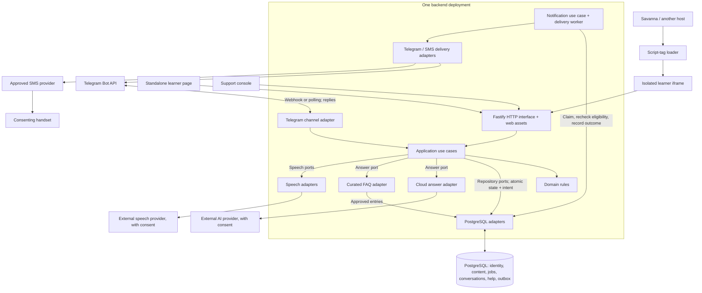
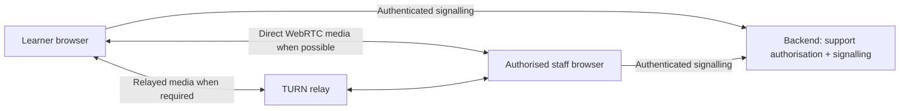
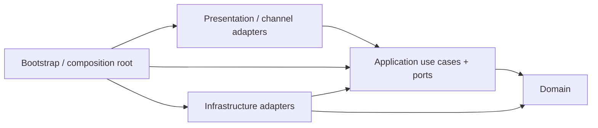

# Architecture and implementation plan

Status: target architecture, not an existing application. Read [spec.md](spec.md) for behaviour and [issues.md](issues.md) for implementation order. Inspect the current project before each issue; this tree is not permission to scaffold unused files.

## Runtime shape

The arrows below show runtime calls/data flow, **not source-code imports**. The browser never talks directly to PostgreSQL or holds provider credentials. Approved course/job content and delivery intents are stored in the same PostgreSQL instance, not separate unnamed stores.



The worker reads committed delivery intents through persistence interfaces; the database does not execute or push messages itself. The standalone page can also read its explicitly prepared, non-restricted FAQ cache offline without reaching the backend. Direct tutoring replies use the channel/HTTP response path; durable alerts and support notifications use the worker.

### Screen sharing is a separate media path



Signalling authorises/negotiates the session; the screen media takes the direct or relay path, **not both by requirement**. The learner controls capture and stop. Screen media is never routed to the tutor or recorded by this application. TURN is a network dependency when required, not a new business microservice.

Deploy one backend and one PostgreSQL instance initially; serve web assets and the embed loader through the documented deployment. The delivery worker belongs to the same backend deployment and uses durable database state. No Redis or separate queue product is needed initially. HTTPS, public callback/relay reachability, and suitable hosting remain provisioning requirements, not assumptions about organiser services.

## Stack and seams

| Concern | Agreed choice | Constraint |
|---|---|---|
| Backend | TypeScript, Node.js, Fastify | Supported compatible versions pinned during bootstrap, not guessed in this spec |
| Web | React + Vite | Functional React; accessible native controls first |
| Persistence | PostgreSQL | Transactions, constraints, explicit migrations, real-database integration tests |
| Workspace | pnpm | Small workspace, reproducible lockfile |
| Packaging | Docker Compose | Database readiness, migrations, and application readiness are different checks |
| Contracts | JSON-compatible transport schemas + OpenAPI | Validate requests and responses; never import transport concerns into domain |
| Automated tests | Vitest, Playwright + axe | Manual device/co-designer verification remains required |
| Provider variability | Small application-owned interfaces | Cloud answer + FAQ are real alternatives; do not build speculative provider frameworks |

The AI, retrieval, speech, SMS, host-identity, and media-relay selections are bounded evaluation/integration decisions. ORM/query library, request-library, streaming versus completed-answer response, and job-queue helper are implementation choices within this architecture. Prefer the smallest well-supported approach; document consequential choices with current primary sources and a runnable proof. Escalate if a choice changes accepted behaviour, introduces external data sharing, paid provisioning, or a new deployment dependency.

## Dependency direction and OO design

Here arrows mean **source-code dependencies** (the importer points to what it imports), not the runtime request direction. Infrastructure implements ports owned by application; application does not import its concrete adapters.



- A **module** hides meaningful behaviour behind a small **interface**. Its interface includes identity/scope requirements, ordering, failure states, and side effects, not just method signatures.
- Application use cases are classes with explicit constructor-injected dependencies. Meaningful domain entities enforce invariants; simple transformations can remain functions.
- Domain/application code cannot import Fastify, a database driver, Telegram SDKs, or AI SDKs. Adapters contain those details.
- HTTP handlers and Telegram adapters translate inputs/results and call the same use cases. Channel adapters do not duplicate grounding, access-control, matching, or lifecycle rules.
- Composition beats inheritance. No universal base service, generic repository for every table, reflection-based DI container, or pass-through layers.
- Each module owns its persistence. Other modules call its application interface, not its tables or repositories. Transactions spanning modules are coordinated by application orchestration through transaction-aware interfaces; do not add an event bus merely to avoid a method call.
- A shared transaction context may be supplied by infrastructure without leaking driver types inward. The action and outbox append must remain atomic; a fake transaction abstraction which only sequences two commits is unacceptable.

## Target folder structure

This is a **target layout**, not a claim that the application files exist. Only the Markdown planning/workflow files currently exist. Root package files, Compose/configuration, CI, `apps`, `packages`, and `fixtures` are created by their owning implementation issues as needed. Compact entries such as `grilling/SKILL.md` mean a file inside that directory; no brace-expanded placeholder paths are used.

```text
Hackaton/
├── AGENTS.md
├── README.md
├── package.json                         # Planned workspace scripts
├── pnpm-workspace.yaml                  # Planned workspace membership
├── pnpm-lock.yaml                       # Generated by approved dependency install
├── compose.yaml                         # Planned runtime packaging
├── .env.example                         # Planned names/defaults; no secrets
├── .agents/
│   ├── skills/
│   │   ├── grilling/SKILL.md
│   │   ├── to-spec/SKILL.md
│   │   ├── to-tickets/SKILL.md
│   │   ├── implement/SKILL.md
│   │   └── code-review/SKILL.md
│   └── agents/
│       ├── standards-reviewer.md
│       ├── spec-reviewer.md
│       └── fix-guard.md
├── .github/
│   ├── pull_request_template.md
│   └── workflows/                       # Planned CI using real package commands
├── docs/
│   ├── spec.md
│   ├── architecture.md
│   ├── decisions.md
│   ├── issues.md
│   ├── verification.md
│   └── conformance.md
├── apps/
│   ├── api/
│   │   ├── package.json
│   │   ├── src/
│   │   │   ├── bootstrap/
│   │   │   │   ├── app.ts
│   │   │   │   ├── dependencies.ts
│   │   │   │   └── config.ts
│   │   │   ├── modules/
│   │   │   │   ├── identity/
│   │   │   │   ├── content/
│   │   │   │   ├── tutoring/            # Example module layout
│   │   │   │   │   ├── domain/
│   │   │   │   │   │   ├── conversation.ts
│   │   │   │   │   │   └── answer.ts
│   │   │   │   │   ├── application/
│   │   │   │   │   │   ├── use-cases/
│   │   │   │   │   │   │   └── ask-question.ts
│   │   │   │   │   │   └── ports/
│   │   │   │   │   │       ├── answer-provider.ts
│   │   │   │   │   │       ├── content-retriever.ts
│   │   │   │   │   │       └── conversation-repository.ts
│   │   │   │   │   ├── infrastructure/
│   │   │   │   │   │   ├── ai/
│   │   │   │   │   │   └── persistence/
│   │   │   │   │   └── presentation/
│   │   │   │   │       └── http/
│   │   │   │   ├── help/
│   │   │   │   ├── careers/
│   │   │   │   └── notifications/       # Owns delivery use cases/adapters
│   │   │   ├── channels/
│   │   │   │   └── telegram/            # Inbound transport, not domain logic
│   │   │   └── infrastructure/
│   │   │       ├── database/
│   │   │       │   ├── connection.ts
│   │   │       │   └── migrations/
│   │   │       └── http/
│   │   │           ├── authentication.ts
│   │   │           └── error-handler.ts
│   │   └── tests/
│   │       └── integration/            # Real-database / cross-module checks
│   └── web/
│       ├── package.json
│       ├── src/
│       │   ├── app/
│       │   ├── features/
│       │   │   ├── assistant/
│       │   │   ├── voice/
│       │   │   ├── human-help/
│       │   │   ├── careers/
│       │   │   └── support-console/
│       │   └── shared/
│       │       ├── api/
│       │       ├── accessibility/
│       │       ├── i18n/
│       │       └── ui/                  # Only actually reused UI
│       └── tests/
│           └── e2e/
├── packages/
│   ├── contracts/
│   │   ├── package.json
│   │   └── src/                        # Transport schemas, not domain logic
│   └── embed/
│       ├── package.json
│       └── src/                        # Loader, frame messaging, teardown
└── fixtures/
    ├── courses/
    ├── jobs/
    └── evaluations/
```

Other backend modules use the same layer pattern only as needed. Focused unit tests live beside their implementation. Avoid an empty directory for each possible entity. The documentation tree exists now; application paths are proposed locations.

## Module ownership and application interfaces

Names below describe use cases, not a mandatory class/file for each row. Keep the externally used interface small and test through it.

| Module | Owned state/behaviour | Principal use cases and results |
|---|---|---|
| Identity | Principal/course scope, channel links, permission/consent checks | Resolve authenticated principal; authorise course/resource; issue/consume single-use channel link; revoke link |
| Content | Approved source version/section, language, allowed audience, FAQ pack | Import validated source; retrieve authorised passages; resolve permitted citation; publish versioned FAQ |
| Tutoring | Owned conversations/messages, citations, answer lifecycle | Ask question; return grounded answer / insufficient evidence / unavailable; list own messages; clear history |
| Help | Request owner/assignee, shared context, messages, unread state, sharing authorisation | Request help; list permitted queue; claim; reply; cancel/resolve; authorise/terminate sharing |
| Careers | Approved jobs, matching subscriptions, accommodation request | Import job; answer authorised job query via grounding logic; subscribe/unsubscribe; submit reviewed request to coordinator |
| Notifications | Durable delivery intent, attempts/leases, channel outcomes | Enqueue within transaction; claim due work; dispatch; record success/failure/unknown; retry only when safe |

Help and careers can reuse grounding/presentation behaviours through explicit application interfaces; do not make all modules depend on the HTTP tutoring controller. Identity is checked on both list and individual-object access. Support queue summaries cannot leak raw accommodation text to every staff user.

### Persistence outline

Implement tables incrementally with the owning issue, not as a giant initial schema. Suggested record groups:

- Identity/channel links: institution subject, role/course grants or resolved host claims, linked provider subject, one-time-link digest/expiry/use marker, consent records.
- Approved content: source/version, language, section/chunk, permitted scope, canonical citation target. Index/filter permission scope before exposing evidence.
- Conversations/messages: owner, context, language, message state, text, authorised citation references, creation/expiry timestamps.
- Help requests/messages: learner, assignee, state, consented context snapshot/references, unread cursor, session revocation state. Shared content has its own explicit retention accounting.
- Jobs/subscriptions/accommodations: source job ID/version/validity, filters/channel destination reference/consent, reviewed request and coordinator routing. Do not store diagnosis fields.
- Delivery outbox/attempts: opaque deduplication key, minimal payload or protected reference, state, attempt count, due time, lease expiry, provider ID, safe error category. Scrub sensitive references on content deletion.

Use database uniqueness and conditional updates for one-time links, claims, inbound-update IDs, and logical alert deduplication; application-level 'check then insert' alone is not sufficient under concurrency. Restrict stored/provider payload access; log only opaque request IDs and safe operational metadata.

## Principal data flows

### Grounded answer

1. Resolve principal and authorised content context; validate input, language, size, consent, and rate/concurrency limits.
2. Claim a request/idempotency key to avoid duplicate persisted messages on retry.
3. Retrieve permission-filtered evidence. Do not rely on English-only search behaviour for Amharic; retrieval must pass bilingual and cross-language fixtures where source/answer languages differ.
4. If evidence is absent or external consent is unavailable, return the appropriate explicit limitation/approved FAQ result.
5. Invoke the answer adapter with selected evidence and bounded context. Validate returned citation identifiers against that evidence. Reject unsupported source references and unsafe output rather than laundering them into trusted links.
6. Persist the result under the learner; render the completed answer and citations accessibly. Provider timeout/cancellation returns a recoverable state, not an invented answer. Never hold a database transaction open while waiting for a cloud model.

Provider interface outcomes must distinguish grounded answer, insufficient evidence, timeout/unavailable, and validation failure. A deterministic FAQ adapter returns approved entries and sources rather than free-form generated answers. Semantic answer support is evaluated separately from schema validation; neither a prompt nor a citation check guarantees zero hallucinations.

### Embed and identity

The script creates an iframe on the assistant origin and exposes a small initialise/open/close/teardown lifecycle. Validate `postMessage` source window, exact origin, message schema, and intended audience. Do not place reusable credentials in URLs, DOM attributes, analytics, or logs. Use a short-lived single-use bootstrap exchange whose exact signing/verification contract is determined from Savanna; all secrets remain server-side. Do not depend solely on third-party cookies. Staff access must use its own authenticated, authorised path.

Document CSP/frame permissions, microphone/display-capture delegation, allowed host origins, and how focus returns on close. Sandbox restrictions must be tested against necessary features rather than copied blindly. A development fixture host proves packaging; only the supplied starter proves Savanna integration.

### Durable notifications

Create the business change and logical delivery intent in one database transaction. Worker claims use bounded leases; recover expired leases after restart. Network sends occur outside the transaction. Before each send, recheck eligibility, consent, unsubscribe/cancellation, and job validity.

Internal processing is retryable, not magically exactly once. A timeout/crash after provider acceptance may leave delivery uncertain. Use provider idempotency/status lookup where supported; otherwise preserve `unknown` for authorised reconciliation rather than blind resend. Record provider acceptance separately from confirmed delivery. Non-content deduplication records must survive the necessary retry window without indefinite personal-data storage.

Typical delivery states: `pending`, `leased`, `provider_accepted`, `delivered` (only when supported by evidence), `retry_wait`, `failed`, `unknown`, `cancelled`. Exact naming is implementation-local; observable distinctions are mandatory.

### Support and screen media

Persist support messages before notifying. Read/unread state is per authorised participant; reconnect loads from durable state. Staff claims use a conditional state transition. Cancellation/resolution revokes sharing capability and suppresses obsolete pending notices.

Issue short-lived signalling permissions only for authorised support participants. Signal over an authenticated channel; negotiate browser media separately. Use configured STUN/TURN as required, with temporary credentials. No recording or raw screen material enters application logs or AI context. Test stopping, disconnection, revoked staff access, and unsupported browsers.

## Evidence-led provider selection

Before committing to a consequential provider/library, record in the owning issue: current official documentation/date, candidate and a reasonable alternative, required language/format support, licence, recurring cost, consent/data retention implications, installation requirements, and a focused experiment with results.

Build an approved evaluation set spanning Amharic/English supported questions, paraphrases, source-language differences, missing evidence, adversarial source instructions, invalid citations, noisy/failed voice, and an expired job. Use stable expected sources and human-reviewed answer criteria. Compare actual results, not marketing rank. Select thresholds before comparing candidates; do not lower thresholds afterward to make the chosen provider pass. Exact models, thresholds, hardware, and runtime versions are recorded by their owning evaluation issue, not invented here.

Choose a viable online answer/speech implementation and deterministic FAQ fallback; self-hosting an entire local model is not required when the FAQ meets the agreed fallback. No paid provisioning without explicit authorisation. Source and provider limitations that compromise a mandatory criterion are blockers, not reasons to quietly change the criterion.

## Primary technical references

These supported planning, not a claim of implementation compatibility. Recheck when selecting concrete versions/providers.

- [Fastify validation/serialization](https://fastify.dev/docs/latest/Reference/Validation-and-Serialization/) and [OpenAPI plugin](https://github.com/fastify/fastify-swagger).
- [Vite library mode](https://vite.dev/guide/build#library-mode), [pnpm workspaces](https://pnpm.io/workspaces).
- [Cross-frame messaging](https://developer.mozilla.org/en-US/docs/Web/API/Window/postMessage), [microphone permissions](https://developer.mozilla.org/en-US/docs/Web/API/MediaDevices/getUserMedia), [service-worker scope](https://developer.mozilla.org/en-US/docs/Web/API/ServiceWorkerContainer/register).
- [Screen capture](https://developer.mozilla.org/en-US/docs/Web/API/MediaDevices/getDisplayMedia), [browser compatibility data](https://github.com/mdn/browser-compat-data/blob/main/api/MediaDevices.json), [WebRTC TURN guidance](https://webrtc.org/getting-started/turn-server).
- [Telegram Bot API](https://core.telegram.org/bots/api), [Twilio Ethiopia route guidance](https://www.twilio.com/en-us/guidelines/et/sms), [AfroMessage developer entry point](https://afromessage.com/developers). AfroMessage is an unverified candidate, not promised access.
- [PostgreSQL locking](https://www.postgresql.org/docs/current/sql-select.html), [Compose readiness](https://docs.docker.com/compose/how-tos/startup-order/), [Playwright accessibility testing](https://playwright.dev/docs/accessibility-testing).
