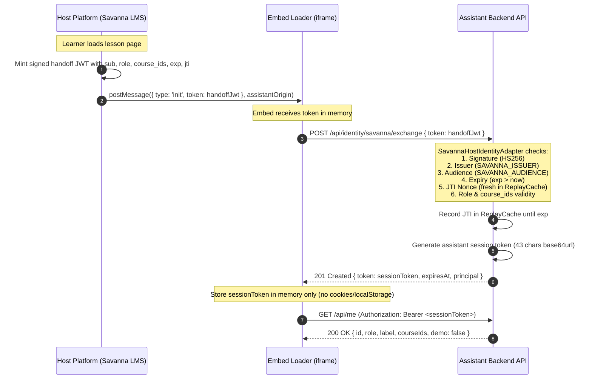

# Savanna Host Identity Handoff Contract

**Status:** Approved Specification & Implementation Reference  
**Tracking Issues:** [#102 (T3-004-B)](https://github.com/EyasuGet/Hackaton/issues/102) · [#103 (T3-004)](https://github.com/EyasuGet/Hackaton/issues/103)  
**Applicable Decisions:** [D10 (Decisions Register)](../decisions.md#locked-choices) · [D06 (Decisions Register)](../decisions.md#locked-choices)  
**Implementation Modules:**
- Domain Port: [`apps/api/src/modules/identity/domain/host-identity-adapter.ts`](../../apps/api/src/modules/identity/domain/host-identity-adapter.ts)
- Infrastructure Adapter: [`apps/api/src/modules/identity/infrastructure/savanna-host-identity-adapter.ts`](../../apps/api/src/modules/identity/infrastructure/savanna-host-identity-adapter.ts)
- Contract Tests: [`apps/api/src/modules/identity/savanna-identity-handoff.test.ts`](../../apps/api/src/modules/identity/savanna-identity-handoff.test.ts)

---

## 1. Security Architecture & Threat Model

### Never Trust Client-Supplied or DOM-Scraped Identifiers
In LMS host environments (such as ALX Savanna), host HTML pages often render learner names, user IDs (`data-user-id`, `data-learner-id`), and form authenticity tokens. **None of these values are trusted credentials.**
- DOM attributes and global JavaScript variables are trivial for a learner, browser extension, or malicious script to mutate in DevTools.
- If the assistant accepted an arbitrary user ID or course ID from the host DOM, any learner could access other learners' private tutoring records, tutor conversations, and human-help tickets, or forge course enrollments.
- Therefore, all identity, roles, and course grants MUST derive strictly from a cryptographically signed token minted by the host backend and verified server-side.

### Never Rely Solely on Third-Party Cookies
Embedding the assistant in an `<iframe>` across distinct origins (e.g. host `https://savanna.alxafrica.com` embedding assistant `https://assistant.alxafrica.com`) subjects network traffic to modern browser cookie partitioning and third-party cookie restrictions:
- Apple Safari Intelligent Tracking Prevention (ITP) blocks third-party cookies by default.
- Mozilla Firefox Enhanced Tracking Protection (ETP) isolates cookies per top-level site.
- Google Chrome Privacy Sandbox partitions cookies (CHIPS) or blocks third-party cookies.
- Relying on session cookies inside cross-origin iframes causes silent authentication failures and broken sessions.
- **Contract Mandate:** Authentication uses an explicit, postMessage-delivered, single-use signed handoff token exchanged for an in-memory bearer session token (`Authorization: Bearer <token>`).

---

## 2. Token Specification & Claims Schema

The host LMS server mints a JSON Web Token (JWT) signed using HMAC-SHA256 (`HS256`) with a shared, high-entropy signing secret (`SAVANNA_SIGNING_SECRET`).

### Header
```json
{
  "alg": "HS256",
  "typ": "JWT"
}
```
*Note: The assistant strictly rejects `alg: "none"` and any algorithm other than `HS256`.*

### Payload (Claims)
```json
{
  "sub": "savanna_usr_9f81a7b4",
  "name": "Abebe Bikila",
  "role": "learner",
  "course_ids": [
    "savanna-va1-future-of-va-industry",
    "demo-time-management-am"
  ],
  "iss": "https://savanna.alxafrica.com",
  "aud": "https://assistant.alxafrica.com",
  "exp": 1731673800,
  "iat": 1731672900,
  "jti": "550e8400-e29b-41d4-a716-446655440000"
}
```

### Claim Definitions & Validation Rules

| Claim | Type | Required | Description & Validation Rule |
|---|---|---|---|
| `sub` | `string` | **Yes** | Unique, immutable subject identifier in host platform. Must be a non-empty string. Maps directly to `Principal.id`. |
| `iss` | `string` | **Yes** | Host identity provider URI. Must strictly match configured `SAVANNA_ISSUER` (e.g. `https://savanna.alxafrica.com`). |
| `aud` | `string` or `string[]` | **Yes** | Intended audience. Must match configured `SAVANNA_AUDIENCE` or registered allowed host origins. |
| `exp` | `number` | **Yes** | Expiration timestamp (UNIX epoch seconds). Must be strictly greater than server `now`. Short TTL recommended (e.g. 5–15 minutes). |
| `iat` | `number` | No | Issuance timestamp (UNIX epoch seconds). Must not exceed `now + clockToleranceMs` (default 60s tolerance for clock skew). |
| `jti` | `string` | **Yes** | Unique token ID / cryptographic nonce. Enforced single-use via `ReplayCache`; replayed JTIs are immediately rejected. |
| `role` | `string` | **Yes** | Authorized role in the host system. Must be one of `'learner' \| 'support' \| 'teacher'`. Any unrecognized or elevated role (e.g. `admin`, `superadmin`) is rejected with `invalid_role`. |
| `course_ids` | `string[]` | **Yes** | Explicit list of course identifiers granted to this user. Must be an array of strings. Wildcards and non-string elements are rejected. |
| `name` | `string` | No | Optional human display name. Maps to `Principal.label`. Defaults to `sub` if omitted or empty. |

---

## 3. Bootstrap & Handoff Lifecycle



---

## 4. Error Codes & Rejection Envelope

When handoff token validation fails, the adapter and HTTP endpoints return structured error codes:

| Error Code | HTTP Status | Trigger Condition |
|---|---|---|
| `missing_token` | `400 Bad Request` | No token provided, empty string, or whitespace-only. |
| `invalid_format` | `400 Bad Request` | Token is not a valid 3-segment dot-separated JWT or has invalid JSON. |
| `invalid_signature` | `401 Unauthorized` | Signature does not match computed HMAC-SHA256, tampered payload, or `alg: "none"`. |
| `token_expired` | `401 Unauthorized` | Current timestamp is at or past the token's `exp` claim. |
| `token_not_yet_valid` | `401 Unauthorized` | Token's `iat` timestamp is in the future beyond allowed clock skew tolerance (60s). |
| `token_replayed` | `401 Unauthorized` | Token with this `jti` has already been exchanged/consumed in the single-use replay cache. |
| `invalid_issuer` | `403 Forbidden` | Token `iss` claim does not match configured `SAVANNA_ISSUER`. |
| `invalid_audience` | `403 Forbidden` | Token `aud` claim does not match configured `SAVANNA_AUDIENCE` or allowed origins. |
| `invalid_role` | `403 Forbidden` | Token `role` claim is not in `['learner', 'support', 'teacher']` (e.g. forged privilege escalation). |
| `invalid_claims` | `400 Bad Request` | Missing or invalid required claims (e.g. empty `sub`, non-array `course_ids`, non-numeric `exp`). |

---

## 5. Embed Consumer Integration Guidelines

1. **Host-Side Implementation:**
   The host application must generate the handoff token on the server side using the configured `SAVANNA_SIGNING_SECRET`. The secret must NEVER be exposed in frontend JavaScript bundles, client templates, or source code.
2. **Iframe Communication:**
   Tokens must be passed via `postMessage` with an explicit target origin (`https://assistant.alxafrica.com`), NEVER with wildcard `'*'`.
3. **Session Token Storage:**
   The client application retains the exchanged session token in JavaScript memory for the lifetime of the page sitting. It is NEVER written to `localStorage`, `sessionStorage`, cookies, DOM attributes, or query parameters.
4. **Logout & Revocation:**
   When the learner signs out of the host platform or closes the assistant, calling `adapter.revokeSession(sessionToken)` revokes the session immediately, preventing any subsequent requests from using that credential.
