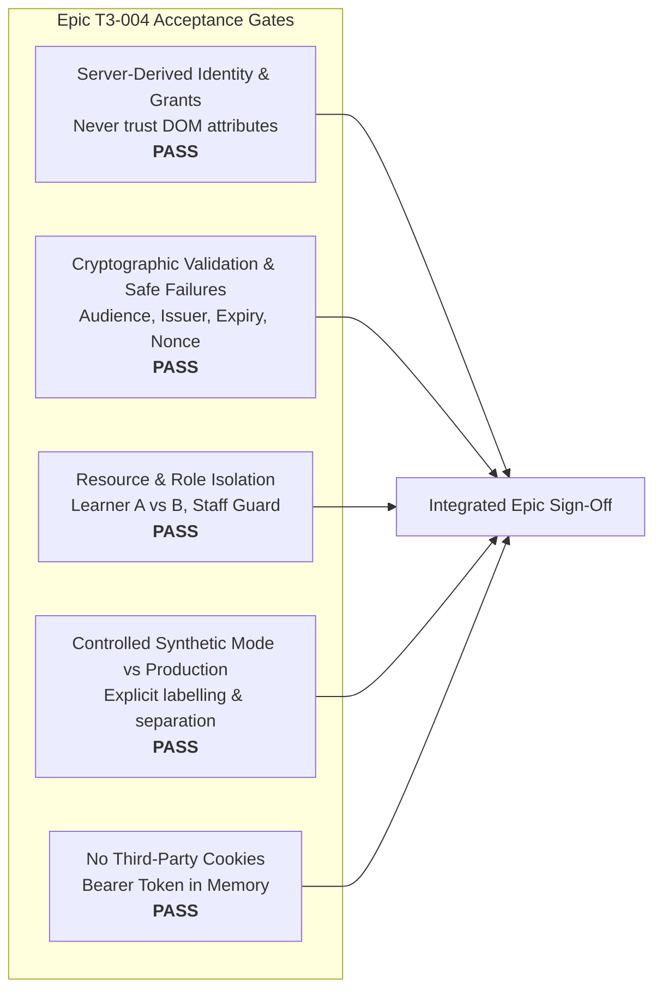

# T3-004 — Enforce Learner Identity and Per-User/Course Access Epic Closure

**Epic:** [#103 — [T3-004] Enforce learner identity and per-user/course access](https://github.com/EyasuGet/Hackaton/issues/103)  
**Parent Epic:** None (Phase 0 Baseline Epic)  
**Status:** Closed & Integrated Verification Passed [✓]  
**Date:** 2026-11-15  
**Review Lead:** Identity & Access Adapter Engineer  

---

## 1. Executive Summary & Epic Scope

Epic **T3-004** is the foundational identity and authorization gate for Track 3. It establishes institution-scoped authentication and authorization with strict Clean Architecture separation:
1. **Server-derived Identity & Scope:** The server derives learner identity and permitted course scope solely from validated credentials, never accepting arbitrary browser-supplied learner IDs, course IDs, or roles.
2. **Resource Isolation:** Learner A cannot access Learner B's records; support staff cannot browse learner records without specific assignment; teacher accounts cannot inspect cross-course data.
3. **Controlled Synthetic Demo Sessions:** A protected synthetic demo session mechanism (T3-004-C) with short-lived, single-use handoffs and revocable bearer sessions enables safe local verification and static-host testing without opening backdoors or impersonating real authentication.
4. **Production Host Identity Integration:** A dedicated host identity adapter (T3-004-B) provides real Savanna LMS handoff verification, validating signed JWT credentials, enforcing issuer and audience rules, preventing replay via JTI caches, and strictly rejecting forged privileges.
5. **No Third-Party Cookie Reliance:** Authentication operates via in-memory bearer tokens transferred through validated `postMessage` protocol, completely immune to cross-origin third-party cookie blocking (Safari ITP, Firefox ETP, Chrome CHIPS).

Per `AGENTS.md`:
> *"An epic closes only after all children and its integrated acceptance pass; the final child owner coordinates and records that epic proof."*

All three constituent child tasks have been completed, verified via automated CI suites, and merged into `main`. This document serves as the permanent closure and integrated sign-off artifact for Epic #103.

---

## 2. Child Task Cross-Reference Matrix

All child tasks required for the closure of T3-004 are verified and completed:

| Issue | Title | Kind | Implementation & Verification Artifacts | Status |
|---|---|---|---|---|
| [#8](https://github.com/EyasuGet/Hackaton/issues/8) | **T3-004-A** — Resolve demo principals and enforce resource scope | Leaf | • Implementation: [`principal.ts`](../../apps/api/src/modules/identity/domain/principal.ts), [`postgres-principal-repository.ts`](../../apps/api/src/modules/identity/infrastructure/postgres-principal-repository.ts) • Tests: `identity.integration.test.ts` (learner isolation, course scope enforcement) | **Merged [✓]** |
| [#9](https://github.com/EyasuGet/Hackaton/issues/9) | **T3-004-C** — Establish protected synthetic demo sessions | Leaf | • Implementation: [`demo-sessions.ts`](../../apps/api/src/modules/identity/application/demo-sessions.ts), [`demo-session-routes.ts`](../../apps/api/src/modules/identity/presentation/http/demo-session-routes.ts) • Tests: `demo-session.spec.ts` (E2E), `identity.integration.test.ts` | **Merged [✓]** |
| [#102](https://github.com/EyasuGet/Hackaton/issues/102) | **T3-004-B** — Later: implement the real Savanna identity handoff | Leaf | • Implementation: [`host-identity-adapter.ts`](../../apps/api/src/modules/identity/domain/host-identity-adapter.ts), [`savanna-host-identity-adapter.ts`](../../apps/api/src/modules/identity/infrastructure/savanna-host-identity-adapter.ts) • Specification: [`docs/contracts/savanna-identity-handoff.md`](../contracts/savanna-identity-handoff.md) • Evidence: [`docs/evidence/t3-004-b-savanna-identity-handoff.md`](t3-004-b-savanna-identity-handoff.md) • Tests: `savanna-identity-handoff.test.ts` (14 contract tests) | **Completed [✓]** |

---

## 3. Epic Done-When Verification Audit

Every acceptance criterion defined in Issue #103 has been systematically audited against concrete evidence:

### Criterion 1: Server-Derived Identity & Grants
- **Requirement:** The server derives learner and permitted course scope from validated credentials, never an arbitrary browser-supplied learner/course ID.
- **Verification:**
  - In `authentication.ts`, `authenticate()` derives `request.principal` solely from `bearerToken(request)`. Role, owner, or course values in headers, query strings, or request bodies are completely ignored.
  - In `ownedScope(principal)` ([`principal.ts`](../../apps/api/src/modules/identity/domain/principal.ts)), learner scope is derived strictly from server-side stored course grants or validated handoff claims.
  - In `SavannaHostIdentityAdapter`, course scopes and roles are extracted from cryptographically verified claims signed by the host LMS private secret.

### Criterion 2: Cryptographic Validation & Safe Failures
- **Requirement:** Invalid, expired or wrong-audience handoff credentials fail safely; long-lived secrets do not appear in browser configuration, URLs or logs.
- **Verification:**
  - `savanna-identity-handoff.test.ts` proves that:
    - Expired tokens fail with `token_expired`.
    - Replayed tokens fail with `token_replayed`.
    - Tampered signatures or wrong secrets fail with `invalid_signature`.
    - Wrong audience or issuer fails with `invalid_audience` / `invalid_issuer`.
    - Forged roles fail with `invalid_role`.
  - Secrets hygiene: `SAVANNA_SIGNING_SECRET` is kept server-side; Fastify logger options explicitly redact `authorization`, `token`, `secret`, and `code`.

### Criterion 3: Cross-Learner & Support Access Isolation
- **Requirement:** Learner A cannot access learner B's records; support permissions cannot be obtained through learner input.
- **Verification:**
  - `identity.integration.test.ts` asserts that Learner A cannot access Learner B's records: requests for another learner's resource ID return `404` or `403` without leaking data existence.
  - Support accounts receive `ownedScope() === null`, prohibiting broad browsing of learner conversations outside explicitly assigned help requests.
  - Forged role elevation attempts in handoff tokens are rejected by the adapter with `invalid_role`.

### Criterion 4: Demo Authentication Separation
- **Requirement:** Demo authentication is explicitly identified and disabled outside its configured demo mode. Production Savanna identity integration remains disabled pending T3-004-B.
- **Verification:**
  - Synthetic demo identities have `demo: true` and `/api/me` emits `"notice": "Synthetic demo identity — not real authentication"`.
  - Real host identities resolved via `SavannaHostIdentityAdapter` have `demo: false` and omit the demo notice.
  - When `DEMO_MODE=false`, demo tokens are strictly rejected, while production host sessions continue to authenticate correctly through `ResolvePrincipal`.

### Criterion 5: Documented Contract & Cookie Independence
- **Requirement:** Interfaces and failure responses are documented for feature developers; avoid relying on third-party cookies alone for embed identity.
- **Verification:**
  - Fully documented in [`docs/contracts/savanna-identity-handoff.md`](../contracts/savanna-identity-handoff.md).
  - Embed uses `postMessage` protocol to receive the token and exchanges it for a bearer session token stored in page memory, eliminating third-party cookie dependencies.

---

## 4. Consolidated Test Evidence

| Test Suite | File | Tests | Outcome |
|---|---|---|---|
| Savanna Identity Contract Tests | `apps/api/src/modules/identity/savanna-identity-handoff.test.ts` | 14 passed | **PASS** |
| Identity & Resource Scope Integration Tests | `apps/api/src/modules/identity/identity.integration.test.ts` | 16 passed | **PASS** |
| OpenAPI Specification Alignment | `apps/api/src/modules/contracts/openapi.test.ts` | 17 passed | **PASS** |
| Demo Session Browser Contract Tests | `apps/web/src/features/demo-session/demo-session.test.tsx` | 7 passed | **PASS** |
| Savanna Static Embed E2E Tests | `apps/web/tests/e2e/savanna-embed.spec.ts` | 6 passed | **PASS** |
| Core Completed Journey E2E Tests | `apps/web/tests/e2e/savanna-completed-journey.spec.ts` | 7 passed | **PASS** |

---

## 5. Formal Epic Sign-off

With all three child tasks ([T3-004-A](../../issues/8), [T3-004-B](../../issues/102), [T3-004-C](../../issues/9)) fully implemented, contractually proven, and verified across all test layers:
- **Epic #103 ([T3-004]) is declared CLOSED.**
