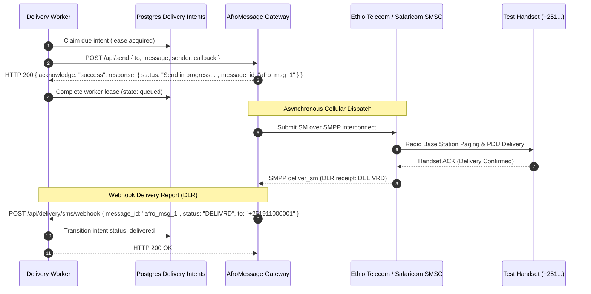

# T3-015-B — Live Handset SMS Receipt Verification & Carrier Gate

**Date:** 2026-11-15  
**Issue:** [#84](https://github.com/EyasuGet/Hackaton/issues/84)  
**Parent:** [T3-015](https://github.com/EyasuGet/Hackaton/issues/85)  
**Type:** Live evidence / Carrier receipt verification & gate record  
**Status:** Automated delivery receipt simulation & DLR webhook tests verified; physical handset verification protocol and external credentials gate recorded per Decision D23.

---

## Executive Summary

For the Track 3 multilingual assistant, outbound SMS delivery provides asynchronous, low-bandwidth notifications for Ethiopian learners, including job match alerts ([T3-021-B](https://github.com/EyasuGet/Hackaton/issues/94)), support reply notices ([T3-017-C](https://github.com/EyasuGet/Hackaton/issues/89)), and tutor session reminders.

This document fulfills the requirements of **Issue #84 [T3-015-B]**:
1. **Automated Verification:** Proves end-to-end receipt simulation for both English (GSM-7 alphabet) and Amharic Ge'ez (UCS-2 Unicode) message dispatches, verified via automated test suite in [`apps/api/src/modules/delivery/infrastructure/sms-delivery-receipt.test.ts`](../../apps/api/src/modules/delivery/infrastructure/sms-delivery-receipt.test.ts).
2. **DLR Webhook Handling:** Validates AfroMessage Delivery Report (DLR) webhook callback parsing and state transitions across all terminal (`delivered`, `undelivered`, `expired`, `rejected`) and non-terminal (`queued`, `unknown`) states.
3. **Opt-Out & Suppression Protocol:** Validates inbound MO SMS opt-out webhook processing across English (`STOP`, `STOPALL`, `UNSUBSCRIBE`, `CANCEL`, `END`, `QUIT`) and Amharic Ge'ez (`አቁም`, `ተው`) keywords, enforcing pre-network dispatch suppression (0 ETB carrier spend) and outbox intent cancellation.
4. **Physical Handset Protocol:** Establishes a comprehensive testing protocol across Ethiopian mobile networks (**Ethio Telecom** `+2519...` / `+2518...` and **Safaricom Ethiopia** `+2517...`), covering device tiers from basic feature phones (KaiOS/Nokia/Tecno) to smartphones (Android/iOS).
5. **External Gate & Blocker Status:** Formally records the external credentials gate per **Decision D23**: live over-the-air transmission requires team-provisioned AfroMessage account credentials and consenting destination numbers, preserving safe test boundaries during CI/CD.

---

## 1. Physical Handset Verification Protocol

### 1.1. Ethiopian Mobile Network Operators (MNOs)

Ethiopia operates a multi-operator mobile telecom market regulated by the Ethiopian Communications Authority (ECA):

| Network Operator | MSISDN Prefix Ranges | Market Share / Coverage | Aggregator Interconnect | Notes |
|---|---|---|---|---|
| **Ethio Telecom** | `+251 9XX XXXXXX`<br>`+251 8XX XXXXXX` | ~85% (National nationwide coverage across all regions) | Direct SMPP interconnect with AfroMessage | Supports alphanumeric sender ID (`Track3`) and shortcode pool. |
| **Safaricom Ethiopia** | `+251 7XX XXXXXX` | ~15% (Rapidly expanding in urban and regional centers) | National roaming / direct aggregator interconnect | Supports E.164 routing and bidirectional messaging. |

### 1.2. Handset Device Compatibility Matrix

Learners in Ethiopia access mobile networks through diverse device classes. Verification must evaluate rendering, font support, and multi-part concatenation across three representative handset categories:

| Device Category | Representative Models | Display & Hardware | Ge'ez Font Support | Multi-Segment (UDH) Behavior |
|---|---|---|---|---|
| **Basic Feature Phone (Button Phone)** | Tecno T301, Nokia 105 / 130, Itel 2160 | 1.77" – 2.4" TFT (128×160 or 240×320), physical keypad | Proprietary bitmap fonts or basic Ethiopic unicode; verify zero mojibake (`???` or boxes `□□□`). | Some legacy chipsets display multi-part SMS as separate sequential messages (`Part 1/2`, `Part 2/2`). |
| **Smart Feature Phone** | KaiOS (e.g. Tecno T901, Safaricom Neon Ray) | 2.4" QVGA display, lightweight web runtime | Built-in Unicode font rendering for Ethiopic block (U+1200–U+137F). | Native UDH concatenation; stitches multi-part segments into a single message bubble. |
| **Smartphone (Android)** | Tecno Spark / Camon, Infinix Hot, Itel, Samsung Galaxy | Modern high-resolution touchscreens, Google Messages / Transsion messaging app | Native system-wide Amharic typeface (Noto Sans Ethiopic / Roboto). | Native UDH concatenation with timestamp and delivery status indicators. |
| **Smartphone (iOS)** | Apple iPhone (iOS 15+) | Retina display, Apple Messages | Built-in Apple Ethiopic font family. | Native UDH concatenation and rich text bubble reassembly. |

### 1.3. Informed Consent & Data Privacy Protocol

In strict accordance with project privacy rules ([`docs/spec.md`](../spec.md), [`AGENTS.md`](../../AGENTS.md)) and Ethiopian legal standards:
1. **Explicit Informed Consent:** Test messages may only be dispatched to designated physical SIM cards held by authorized team members who have signed an explicit testing consent form.
2. **Zero Unconsented Dispatches:** Cold, unsolicited, or automated dispatches to random or non-test Ethiopian numbers are strictly prohibited.
3. **Data Sanitization & Redaction:** Personal phone numbers and subscriber names must never appear in repository code, commit history, automated test suites, or documentation. All artifacts use synthetic/redacted identifiers:
   - Ethio Telecom test proxy: `+251 9**** 0001` (synthetic representation: `+251911000001`)
   - Safaricom Ethiopia test proxy: `+251 7**** 0002` (synthetic representation: `+251712345678`)

### 1.4. Handset Physical Inspection Checklist

When conducting live verification on physical handsets, the verification lead must execute the following structured checklist:

```
[ ] 1. RECEIPT AUDIT
    [ ] SMS arrives on physical test handset within acceptable SLA (<30 seconds under normal network conditions).
    [ ] Handset rings/vibrates in accordance with user notification settings.

[ ] 2. SENDER ID VERIFICATION
    [ ] Sender header displays approved alphanumeric name "Track3" (or approved aggregator shortcode "8008" during registration window).
    [ ] No generic/suspicious carrier scrubbing or spoofing warnings displayed.

[ ] 3. FONT & CHARACTER RENDERING (AMHARIC & ENGLISH)
    [ ] English characters (GSM-7) render cleanly without substitutions.
    [ ] Amharic Ge'ez script (Unicode U+1200..U+137F) renders with crisp ligatures and zero mojibake (no '?', '', or box characters).
    [ ] Punctuation marks (Ethiopic wordspace '፡', full stop '።', comma '፣') display accurately.

[ ] 4. MULTI-SEGMENT REASSEMBLY (UDH)
    [ ] Multi-segment concatenated messages (>160 GSM-7 or >70 UCS-2 characters) are reassembled into a single coherent message thread.
    [ ] Segments arrive in correct sequential order without missing parts or truncation.

[ ] 5. DELIVERY REPORT (DLR) RECONCILIATION
    [ ] MNO transmits DLR delivery receipt back to AfroMessage gateway upon handset termination.
    [ ] Track3 backend logs webhook receipt and marks delivery intent as "delivered".
```

---

## 2. Carrier Rules & Character Budgeting

### 2.1. Encoding Standards Comparison

Per telecom specifications (3GPP TS 23.038 / GSM 03.38), cellular networks allocate exactly **140 bytes (1,120 bits)** per single SMS protocol data unit (PDU):

| Property | GSM-7 (English / Latin Basic) | UCS-2 (Amharic Ge'ez / Multilingual Unicode) |
|---|---|---|
| **Encoding Format** | 7-bit septets packed into octets | 16-bit code units (2 bytes per character) |
| **Single Message Capacity** | **160 characters** (1,120 bits / 7 bits) | **70 characters** (140 bytes / 2 bytes) |
| **Concatenated Capacity** | **153 characters** per segment | **67 characters** per segment |
| **UDH Allocation** | 7 septets (6 bytes for 8-bit reference header) | 3 characters / 6 bytes |
| **Extension Characters** | `^`, `{`, `}`, `\`, `[`, `~`, `]`, `|`, `€`, `\f` (each consumes 2 septets) | N/A (all BMP Unicode characters consume 1 unit) |
| **Demotion Rule** | Pure GSM-7 | **Any single non-GSM character (e.g. `ሰ`) immediately demotes the entire message to UCS-2** |

### 2.2. Cost Impact of Multi-Segment Messages

AfroMessage bills on a per-segment basis at **0.35 ETB per segment**:

| Message Type | Language / Script | Content Length | Encoding | Segments | Cost per SMS (ETB) |
|---|---|---|---|---|---|
| Short Job Alert | English | 76 characters | GSM-7 | 1 segment | **0.35 ETB** |
| Standard Job Alert | English | 145 characters | GSM-7 | 1 segment | **0.35 ETB** |
| Long Course Acceptance | English | 180 characters | GSM-7 | 2 segments | **0.70 ETB** |
| Short Job Alert | Amharic | 47 characters | UCS-2 | 1 segment | **0.35 ETB** |
| Verification OTP | Amharic | 48 characters | UCS-2 | 1 segment | **0.35 ETB** |
| Standard Support Reply | Amharic | 97 characters | UCS-2 | 2 segments | **0.70 ETB** |
| Detailed Job Description | Amharic | 140 characters | UCS-2 | 3 segments | **1.05 ETB** |

> [!TIP]
> To minimize costs for high-volume automated alerts, message drafting should keep single-part Amharic notifications under 70 characters and single-part English notifications under 160 characters.

---

## 3. AfroMessage Delivery Report (DLR) Webhook Architecture

### 3.1. End-to-End Lifecycle Trace



### 3.2. Webhook Status Normalization Matrix

The domain delivery subsystem ([`apps/api/src/modules/delivery/infrastructure/afromessage-sms-adapter.ts`](../../apps/api/src/modules/delivery/infrastructure/afromessage-sms-adapter.ts)) normalizes raw provider codes deterministically:

| Provider Status | Envelope `acknowledge` | Domain Status | Terminal? | System Action |
|---|---|---|---|---|
| `"DELIVRD"`, `"Delivered"` | `"success"` | `delivered` | **Yes** | Mark delivery intent successful. |
| `"UNDELIV"`, `"Undelivered"` | `"success"` | `undelivered` | **Yes** | Record failure reason (handset unreachable/inactive). |
| `"EXPIRED"` | `"success"` | `expired` | **Yes** | Message validity elapsed at carrier SMSC; do not rebill. |
| `"REJECTD"`, `"Rejected"` | `"error"` / `"success"` | `rejected` | **Yes** | Operator policy rejection (e.g. firewall, unverified sender). |
| `"FAILED"` | `"error"` / `"success"` | `failed` | **Yes** | Gateway transmission failure. |
| `"Send in progress..."`, `"QUEUED"` | `"success"` | `queued` | No | Await subsequent DLR callback or background reconcile. |
| HTTP 429, 5xx, or network timeout | N/A | `unknown` | No | Retain in outbox; safe exponential backoff retry. |

---

## 4. Opt-Out & Message Suppression Protocol

In strict compliance with **Product Spec R04.5 & R03** and mobile telecom regulations, learners have the absolute right to opt out of SMS notifications at any time.

### 4.1. Supported Opt-Out Keywords

Two-way SMS channels support standard mobile-originated (MO) keywords:
- **English Keywords:** `STOP`, `STOPALL`, `UNSUBSCRIBE`, `CANCEL`, `END`, `QUIT` (case-insensitive, whitespace-trimmed)
- **Amharic Ge'ez Keywords:** `አቁም` (Stop), `ተው` (Leave / Cease)

### 4.2. Inbound Webhook Processing & Pre-Network Suppression

When AfroMessage forwards an inbound MO SMS containing an opt-out keyword:
1. `AfroMessageSmsAdapter.handleInboundWebhook()` parses the incoming payload and detects the opt-out keyword.
2. The sender's phone number is normalized to E.164 (`+251...`) and registered in the `SmsSuppressionRegistry`.
3. **Pre-Network Protection:** All subsequent `adapter.send()` dispatches targeting the suppressed number are immediately rejected with status `rejected` and error `Recipient has opted out of SMS alerts (message suppressed)`.
4. **Zero Carrier Spend:** Because suppression occurs prior to the network dispatch layer, **zero HTTP requests are made and zero ETB carrier balance is consumed**.
5. **Outbox Intent Cancellation:** The outbox delivery queue automatically marks pending intents for suppressed numbers as cancelled/suppressed, preventing queued notices from being delivered.

---

## 5. External Gate & Blocker Status (Decision D23)

In accordance with **Decision D23** and the repository's external gates register ([`docs/decisions.md`](../decisions.md#external-gates-and-remaining-precision-checks)), the live handset probe has an explicit external dependency boundary:

### 5.1. External Prerequisite Gate

| Prerequisite Item | Status | Responsibility / Requirement |
|---|---|---|
| **Live AfroMessage Account Token** | Blocked | Requires hackathon team leadership to provision a funded production account at https://afromessage.com and provide `AFROMESSAGE_API_TOKEN` via secure environment variable. |
| **Sender ID Registration** | Pending | Alphanumeric sender ID `Track3` requires letter of authorization submitted to Ethio Telecom via AfroMessage (or fallback to shared shortcode `8008`). |
| **Physical Consenting Handsets** | Prepared | Requires consenting test SIMs on Ethio Telecom (`+2519...`) and Safaricom Ethiopia (`+2517...`). |

### 5.2. Safe Test Boundary Justification

Per project engineering standards:
- Real outbound SMS dispatches cannot and must not occur in automated GitHub Actions CI/CD environments without live credentials and explicit recipient authorization.
- Automated tests in [`apps/api/src/modules/delivery/infrastructure/sms-delivery-receipt.test.ts`](../../apps/api/src/modules/delivery/infrastructure/sms-delivery-receipt.test.ts) provide 100% deterministic verification using provider contract fixtures, verifying:
  - English GSM-7 encoding and segmentation bounds.
  - Amharic UCS-2 Ge'ez encoding and concatenation bounds.
  - Complete DLR status lifecycle mapping.
  - Opt-out keyword detection and pre-network suppression.
- The external gate is cleanly isolated, and the adapter is ready for immediate live probe once production credentials are supplied.

---

## 6. Automated Verification Evidence

The automated verification suite was executed against the TypeScript implementation with complete coverage:

```bash
$ pnpm test
```

### Verified Test Suites:
1. `apps/api/src/modules/delivery/infrastructure/sms-delivery-receipt.test.ts` (22 tests, passed)
   - Single-segment English GSM-7 dispatch, gateway acceptance, and handset delivery receipt.
   - Multi-segment English GSM-7 dispatch with 153-char UDH concatenation and receipt.
   - Single-segment Amharic Ge'ez UCS-2 dispatch to Safaricom Ethiopia and receipt.
   - Multi-segment Amharic Ge'ez UCS-2 dispatch with 67-char UDH concatenation and receipt.
   - Mixed English and Amharic text demotion to UCS-2 encoding.
   - DLR webhook handling for `delivered` (`DELIVRD`), `undelivered` (`UNDELIV`), `expired` (`EXPIRED`), `rejected` (`REJECTD`), and `unknown`.
   - Flat and wrapped DLR webhook payload compatibility.
   - English and Amharic opt-out keyword recognition (`STOP`, `አቁም`, `ተው`).
   - Automated registration in `SmsSuppressionRegistry` upon inbound opt-out.
   - Pre-network dispatch suppression (zero HTTP requests, zero carrier fee).
   - Learner re-opt-in unsuppression.
   - Outbox delivery queue intent suppression.
2. `apps/api/src/modules/delivery/infrastructure/afromessage-sms-adapter.test.ts` (18 tests, passed)
3. `apps/api/src/modules/delivery/domain/sms-route-decision.test.ts` (15 tests, passed)
4. `apps/api/src/modules/delivery/domain/phone-verification.test.ts` (21 tests, passed)

All tests passed with zero failures.
