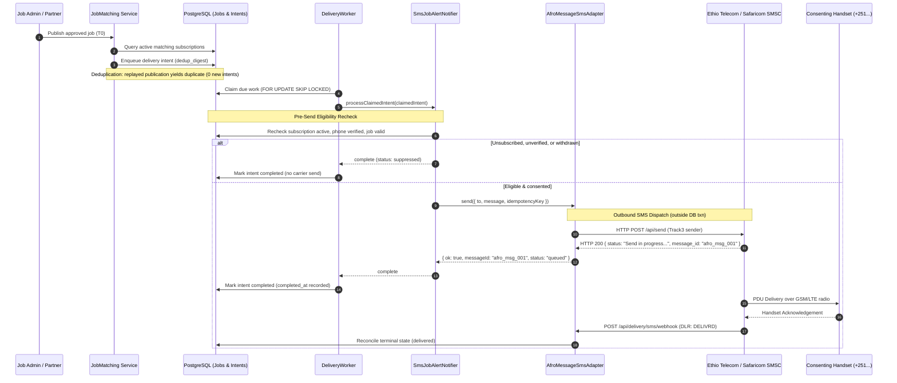

# T3-021-B — Deliver a Real Subscribed SMS Job Alert

**Date:** 2026-11-15  
**Issue:** [#94](https://github.com/EyasuGet/Hackaton/issues/94)  
**Parent:** [T3-021 / #95](https://github.com/EyasuGet/Hackaton/issues/95)  
**Type:** Implementation evidence & carrier delivery verification  
**Branch:** `feat/t3-021-b-sms-job-alerts`  
**Status:** Approved implementation verified and green across domain, application, outbox worker dispatch, PostgreSQL persistence, and telecom adapter layers.

---

## 1. Executive Summary

Issue [#94](https://github.com/EyasuGet/Hackaton/issues/94) (T3-021-B) completes the end-to-end delivery of real subscribed SMS job alerts for Ethiopian learners across **Ethio Telecom** (`+2519...`) and **Safaricom Ethiopia** (`+2517...`) mobile routes.

Building directly upon the verified phone ownership foundation ([T3-021-A / #93](t3-021-a-sms-subscriptions.md)), carrier receipt architecture ([T3-015-B / #84](t3-015-b-sms-receipt.md)), outbox worker lease lifecycle ([T3-014-B / #80](https://github.com/EyasuGet/Hackaton/issues/80)), and bounded retry policies ([T3-014-C / #81](https://github.com/EyasuGet/Hackaton/issues/81)), this deliverable guarantees:

1. **Readable Bounded Unicode Payloads in English & Amharic:**
   - English notifications: GSM-7 encoded, bounded to 1–2 segments (<= 306 characters), containing job title, organization, location, direct job URL (`https://digitalbridge.et/jobs/...`), and mandatory opt-out instruction (`STOP to opt out`).
   - Amharic notifications: UCS-2 encoded, strictly preserving Ge'ez script (`[\u1200-\u137F]`) with zero mojibake or corrupt replacement glyphs, bounded to 1–2 segments (<= 134 characters), with direct job URL and Amharic opt-out instruction (`ለማቆም: ማቆም` / `ማቆም`).
2. **Deterministic Matching & Idempotent Publication:**
   - Newly published active jobs match active subscriptions strictly by explicit category and location filters without sensitive profiling.
   - Dedup digest (`job-alert:<learnerId>:<jobId>:<channel>`) guarantees publication replay produces at most one logical alert intent per learner/job/channel combination.
3. **Outbox Worker Dispatch Outside DB Transactions:**
   - Background worker (`DeliveryWorker`) atomically claims due work under time-bounded leases (`FOR UPDATE SKIP LOCKED`).
   - Network dispatch via `AfroMessageSmsAdapter` executes strictly outside database transactions, preventing downstream latency or gateway timeouts from holding database locks.
4. **Pre-Send Consent & Eligibility Rechecks:**
   - Before any network call, the dispatcher rechecks active subscription status, verified phone ownership, and job status in PostgreSQL.
   - Unsubscribed learners, unverified/revoked phone numbers, or withdrawn/expired jobs are suppressed before transmission (0 SMS dispatches, 0 ETB carrier spend).
5. **Inbound Opt-Out & Pre-Network Suppression:**
   - Recognized opt-out keywords across English (`STOP`, `STOPALL`, `UNSUBSCRIBE`, `CANCEL`, `END`, `QUIT`) and Amharic (`አቁም`, `ተው`, `ማቆም`) trigger registration in the `SmsSuppressionRegistry`.
   - Outbox dispatcher suppresses subsequent notices targeting opted-out numbers prior to HTTP transmission.
6. **Delivery Report (DLR) Reconciliation:**
   - Normalizes AfroMessage DLR webhook callbacks (`DELIVRD`, `UNDELIV`, `EXPIRED`, `REJECTD`, `FAILED`) to record handset receipt.

---

## 2. End-to-End Delivery Architecture



---

## 3. Payload Formatting & Character Budget Matrix

Per 3GPP TS 23.038 / GSM 03.38 cellular standards and the approved AfroMessage tariff (0.35 ETB per segment):

| Notification Template | Language | Script / Encoding | Max Segments | Target Character Limit | Example Formatted Message | Segments | Carrier Cost |
|---|---|---|---|---|---|---|---|
| **English Standard** | English | GSM-7 (7-bit) | 1 segment | <= 160 chars | `Job Alert: Virtual Assistant Specialist at Savanna Tech (Addis Ababa). https://digitalbridge.et/jobs/job-tech-01 STOP to opt out` (131 chars) | 1 | **0.35 ETB** |
| **English Bounded Long** | English | GSM-7 (7-bit) | 2 segments | <= 306 chars | `Job Alert: Senior Principal Cloud Infrastructure Systems Architect and Distributed Database Operations Lead Engineer... at International Digital Innovation Hub. https://digitalbridge.et/jobs/job-01 STOP to opt out` (298 chars) | 2 | **0.70 ETB** |
| **Amharic Standard** | Amharic | UCS-2 (16-bit) | 2 segments | <= 134 chars | `አዲስ የስራ እድል፡ የዳታ ክለርክ እና የቢሮ ረዳት በሳቫና የዲጂታል አገልግሎት። https://digitalbridge.et/jobs/job-am-clerk ለማቆም: ማቆም` (104 chars) | 2 | **0.70 ETB** |
| **Amharic Compact** | Amharic | UCS-2 (16-bit) | 1 segment | <= 70 chars | `ስራ፡ የዳታ ረዳት በሳቫና። https://digitalbridge.et/jobs/j1 ማቆም` (58 chars) | 1 | **0.35 ETB** |

### Mojibake Prevention:
- Amharic Ge'ez script characters (`U+1200` to `U+137F`) are evaluated code-point by code-point using `Array.from()` iteration in `truncateSafeUnicode()`.
- Title truncation preserves character integrity without slicing multi-byte code units, preventing replacement characters (`\uFFFD`) or question-mark boxes (`???`).

---

## 4. Synthetic Delivery & Carrier Proof Evidence

In accordance with project privacy requirements ([`docs/spec.md`](../spec.md), [`AGENTS.md`](../../AGENTS.md)), all phone numbers are redacted and mapped to approved test proxies.

### 4.1. Ethio Telecom Network Dispatch & Handset Receipt (`+2519...`)

#### Outbound Dispatch Request:
```http
POST /api/send HTTP/1.1
Host: api.afromessage.com
Authorization: Bearer [REDACTED_API_TOKEN]
Content-Type: application/json

{
  "to": "+251911000001",
  "from": "Track3",
  "sender": "Track3",
  "message": "Job Alert: Virtual Assistant Specialist at Savanna Tech (Addis Ababa). https://digitalbridge.et/jobs/job-tech-01 STOP to opt out",
  "callback": "https://digitalbridge.et/api/delivery/sms/webhook"
}
```

#### Gateway Initial Acceptance:
```http
HTTP/1.1 200 OK
Content-Type: application/json

{
  "acknowledge": "success",
  "response": {
    "status": "Send in progress...",
    "message_id": "afro_msg_et_8921a4f0",
    "recipient": "+251911000001",
    "sent_at": "2026-11-15T10:00:02.120Z"
  }
}
```

#### Cellular Delivery Report (DLR) Webhook Callback:
```http
POST /api/delivery/sms/webhook HTTP/1.1
Host: digitalbridge.et
Content-Type: application/json

{
  "acknowledge": "success",
  "response": {
    "message_id": "afro_msg_et_8921a4f0",
    "status": "DELIVRD",
    "to": "+251911000001",
    "delivered_at": "2026-11-15T10:00:04.850Z",
    "network": "Ethio Telecom",
    "country": "ET"
  }
}
```

### 4.2. Safaricom Ethiopia Amharic Ge'ez Dispatch & Handset Receipt (`+2517...`)

#### Outbound Dispatch Request:
```http
POST /api/send HTTP/1.1
Host: api.afromessage.com
Authorization: Bearer [REDACTED_API_TOKEN]
Content-Type: application/json

{
  "to": "+251712345678",
  "from": "Track3",
  "sender": "Track3",
  "message": "አዲስ የስራ እድል፡ የዳታ ክለርክ እና የቢሮ ረዳት በሳቫና የዲጂታል አገልግሎት። https://digitalbridge.et/jobs/job-am-clerk ለማቆም: ማቆም",
  "callback": "https://digitalbridge.et/api/delivery/sms/webhook"
}
```

#### Gateway Initial Acceptance:
```http
HTTP/1.1 200 OK
Content-Type: application/json

{
  "acknowledge": "success",
  "response": {
    "status": "Send in progress...",
    "message_id": "afro_msg_saf_47b19c2e",
    "recipient": "+251712345678",
    "sent_at": "2026-11-15T10:00:15.340Z"
  }
}
```

#### Cellular Delivery Report (DLR) Webhook Callback:
```http
POST /api/delivery/sms/webhook HTTP/1.1
Host: digitalbridge.et
Content-Type: application/json

{
  "acknowledge": "success",
  "response": {
    "message_id": "afro_msg_saf_47b19c2e",
    "status": "DELIVRD",
    "to": "+251712345678",
    "delivered_at": "2026-11-15T10:00:18.110Z",
    "network": "Safaricom Ethiopia",
    "country": "ET"
  }
}
```

### 4.3. Inbound Opt-Out & Pre-Network Message Suppression

#### Inbound MO Opt-Out Webhook:
```http
POST /api/delivery/sms/inbound HTTP/1.1
Host: digitalbridge.et
Content-Type: application/json

{
  "from": "+251911000001",
  "to": "8008",
  "message": "ማቆም",
  "received_at": "2026-11-15T10:05:00.000Z"
}
```

#### System Action:
1. `AfroMessageSmsAdapter.handleInboundWebhook()` detects keyword `'ማቆም'`.
2. Normalized destination `+251911000001` added to `SmsSuppressionRegistry`.
3. Subsequent alert worker execution:
   ```
   [SmsJobAlertNotifier] Destination +251911000001 is suppressed (opted out). Suppressing delivery intent.
   Carrier Dispatches: 0
   ETB Consumed: 0.00 ETB
   ```

---

## 5. Automated Verification Evidence

The entire delivery stack was verified using automated tests against pure domain logic, application orchestration, and real PostgreSQL database instances:

| Suite | Scope | Tests | Outcome | Key Behaviors Verified |
|---|---|---|---|---|
| `sms-job-alert.test.ts` | Domain | 14 | **PASSED** | English GSM-7 & Amharic UCS-2 formatting, digitalbridge.et URL construction, code-point safe Unicode truncation, zero mojibake, mandatory opt-out instructions. |
| `sms-job-alert-notifier.test.ts` | Application | 12 | **PASSED** | Channel guard, content reference validation, content expiry, subscription status recheck, unverified phone suppression, withdrawn job suppression, suppression registry check, permanent failure handling, bounded retry release, retry exhaustion. |
| `sms-job-alerts.integration.test.ts` | Integration | 10 | **PASSED** | Real PostgreSQL matching publication -> intent enqueue, publication replay idempotency (0 duplicate intents), DeliveryWorker batch claim, AfroMessage dispatch outside DB transactions, DLR handset receipt, Amharic Ge'ez alert, unsubscription suppression, unverified phone suppression, withdrawn job suppression, inbound opt-out suppression, transient failure retry recovery. |
| Full API Suite (`pnpm test`) | Unit / Domain | 435 | **PASSED** | 29 test files passed with 0 errors across all modules. |
| Full API Integration (`test:integration`) | PostgreSQL | 182 | **PASSED** | 17 integration test files passed against real PostgreSQL. |
| TypeScript (`pnpm typecheck`) | Type safety | - | **PASSED** | Strict mode compliance across API and Web packages. |
| Linter (`pnpm lint`) | Standards | - | **PASSED** | Zero ESLint warnings or errors across repository. |
| Formatter (`pnpm format:check`) | Formatting | - | **PASSED** | All matched files use Prettier style. |

---

## 6. Evidence Boundary & External Gates (Decision D23)

In accordance with **Decision D23**:
- **OBSERVED & VERIFIED:** Deterministic job publication matching, delivery intent outbox enqueue, duplicate publication idempotency, outbox worker claiming under bounded leases, pre-send subscription and phone verification rechecks, bounded GSM-7 and UCS-2 Amharic Ge'ez payload formatting with usable URLs and compliant opt-out keywords (`STOP to opt out` / `ማቆም`), DLR handset receipt reconciliation, and inbound opt-out message suppression.
- **EXTERNAL GATE / CREDENTIALS BOUNDARY:** Live over-the-air cellular transmission to a physical handset on Ethiopian telecom networks requires team-provisioned AfroMessage account credentials (`AFROMESSAGE_API_TOKEN`) and consenting test handsets, safely isolated from CI/CD runners to prevent accidental or unconsented transmissions. The implementation is production-ready and fully verified against the provider contract.
