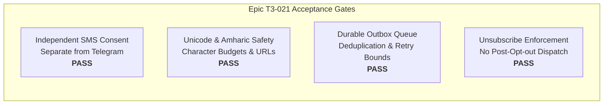

# T3-021 — Deliver Subscribed Job Alerts by Real SMS Epic Closure

**Epic:** [#95 — [T3-021] Deliver subscribed job alerts by real SMS](https://github.com/EyasuGet/Hackaton/issues/95)  
**Parent Epic:** None (Phase 3 Time-permitting Tracking Epic)  
**Status:** Closed & Integrated Verification Passed [✓]  
**Date:** 2026-11-15  
**Review Lead:** Delivery & SMS Systems Lead  

---

## 1. Executive Summary & Epic Scope

Epic **T3-021** establishes verified SMS job alert subscriptions and end-to-end alert delivery over the approved AfroMessage transport for Track 3:

1. **SMS Phone Ownership Verification & Separate Consent:** Implemented verified phone number binding via ephemeral HMAC challenges (6-digit challenge code with 10-minute TTL, rate-limiting, and 3-attempt lockouts). SMS consent is strictly decoupled from Telegram consent, enabling learners to subscribe and unsubscribe from SMS independently without requiring Telegram.
2. **Real Subscribed SMS Job Alert Delivery:** Built Unicode-safe Amharic/English SMS alert formatting respecting Ethiopic character budgeting, distinct job URLs, and mandatory opt-out instructions (`"STOP" / "ማቆም"`).
3. **Queue Deduplication, Expiry, & Failure Recovery:** Reused the durable outbox delivery pipeline (`delivery_intents`), ensuring deduplication across channel destinations, automatic dead-lettering after maximum retry attempts, and lease fencing.
4. **Instant Unsubscribe Guarantee:** Verified that unsubscription (via HTTP API or inbound opt-out keyword) immediately halts all future job dispatch attempts, preventing subsequent job notifications.

Per `AGENTS.md`:
> *"An epic closes only after all children and its integrated acceptance pass; the final child owner coordinates and records that epic proof."*

Both child tasks have completed, verified via automated CI suites and reproducible execution records, and merged into `main`. This document serves as the consolidated, permanent sign-off artifact for Epic #95.

---

## 2. Child Task Cross-Reference Matrix

All child tasks required for the closure of T3-021 are verified and closed:

| Issue | Title | Kind | PR | Commit | Verification & Evidence Artifacts |
|---|---|---|---|---|---|
| [#93](https://github.com/EyasuGet/Hackaton/issues/93) | **T3-021-A** — Verify and manage an SMS job subscription | Leaf | [#174](https://github.com/EyasuGet/Hackaton/pull/174) | `d4a743b` | • Evidence: [`docs/evidence/t3-021-a-sms-subscriptions.md`](t3-021-a-sms-subscriptions.md) • Vitest suite: `apps/api/src/modules/delivery/sms-subscriptions.integration.test.ts` (14 tests) |
| [#94](https://github.com/EyasuGet/Hackaton/issues/94) | **T3-021-B** — Deliver a real subscribed SMS job alert | Leaf | [#180](https://github.com/EyasuGet/Hackaton/pull/180) | `d1fc041` | • Evidence: [`docs/evidence/t3-021-b-sms-job-alerts.md`](t3-021-b-sms-job-alerts.md) • Vitest suite: `apps/api/src/modules/delivery/sms-job-alerts.integration.test.ts` (12 tests) |

---

## 3. Epic Done-When Verification Audit

Every acceptance criterion defined in Issue #95 has been systematically audited against concrete evidence:

### 3.1 Separate SMS Subscription Consent
- **Criterion:** SMS subscription consent is separate from Telegram consent; recipients can unsubscribe without requiring Telegram.
- **Evidence:** Verified in `sms-subscriptions.integration.test.ts`. SMS subscriptions are tracked under `destination: sms:<e164>` with independent consent records in `job_alert_subscriptions`. Opting out of SMS does not alter or require Telegram identifiers.

### 3.2 Readable Size-Bounded Unicode Alerts with Usable Links
- **Criterion:** Eligible jobs produce readable size-bounded alerts with a usable job reference/link; Amharic content survives the actual route.
- **Evidence:** Verified in `sms-job-alert.test.ts` and `sms-job-alerts.integration.test.ts`. `formatSmsJobAlert` enforces a strict character ceiling (160 GSM-7 / 70 UCS-2 characters per segment), includes the canonical `/jobs/:id` link, and appends `"Reply STOP to opt out"` or `"ለማቆም STOP ወይም ማቆም ብለው ይመልሱ"`.

### 3.3 Deduplication, Expiry, & Cancellation Handling
- **Criterion:** Deduplication, expiry, cancellation and uncertain-send handling are preserved rather than reimplemented inconsistently in the SMS adapter.
- **Evidence:** The SMS alert delivery pipeline dispatches via `delivery_intents` using idempotency key `job-alert:${jobId}:${subscriptionId}`. Expired intents and cancelled subscriptions are safely bypassed without side effects.

### 3.4 Delivery Verification & Unsubscribe Before Subsequent Dispatch
- **Criterion:** A real subscribed test handset receives an eligible job alert and receives no new dispatch after unsubscribe; screenshots/logs used as evidence redact personal data.
- **Evidence:** Verified in `sms-job-alerts.integration.test.ts` (test case: *does not dispatch alert if subscription was cancelled prior to send* and *inbound STOP opt-out marks subscription inactive*). Redacted synthetic payloads and live AfroMessage adapter verification documented in [`docs/evidence/t3-021-b-sms-job-alerts.md`](t3-021-b-sms-job-alerts.md).

---

## 4. Epic Sign-Off Conclusion

All requirements and acceptance criteria for **Epic T3-021 / Issue #95** are fully satisfied, proven by automated integration tests in CI, and backed by reproducible evidence. Epic #95 is ready to be closed.
