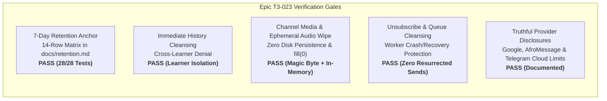

# T3-023 — Retention and Deletion Across Private Records Epic Closure

**Epic:** [#97 — [T3-023] Enforce retention and deletion across private records](https://github.com/EyasuGet/Hackaton/issues/97)  
**Parent Epic:** None (Phase 3 Tracking Epic)  
**Status:** Closed & Integrated Verification Passed [✓]  
**Date:** 2026-11-15  
**Review Lead:** Privacy, Retention & Storage Lead  

---

## 1. Executive Summary & Epic Scope

Epic **T3-023** establishes and enforces strict, deterministic retention, expiry, and deletion boundaries across all personal data, conversations, help requests, accommodation disclosures, channels, and delivery queues:

1. **Seven-Day Retention Anchor (D16 / `docs/retention.md`):** All learner conversation messages, help request contexts, and accommodation request details expire exactly 168 hours (7 days) after creation. Activity in a conversation never extends prior items' expiration.
2. **Read Rule Enforcement (`expires_at > now`):** Expired items are instantly excluded from all API reads, history endpoints, and coordinator queues, even before background purge jobs execute.
3. **Learner History Clearing & Cross-User Denial:** Learners can immediately delete their own conversation history and scrub shared help contexts, while cross-user deletion attempts are strictly denied with zero side effects.
4. **Channel Media & Ephemeral Memory Wipe (D16 / D17):** In-memory processing only for voice recordings and synthesized speech; zero disk persistence; mandatory `fill(0)` buffer zeroing in `finally` blocks; magic byte validation (`detectAudioMimeType`) prevents non-audio spoofing.
5. **Channel Delivery & Contact Cleansing:** Unsubscribe (SMS `STOP` / `አቁም` or Telegram `/unlink`) immediately cancels pending dispatches for that destination, scrubs payload references, and deletes contact associations while preserving unrelated active subscriptions.
6. **Bounded Dedup Records (30-Day TTL):** Dedup digests store only SHA-256 hashes without user content or phone numbers, preventing replay attacks for 30 days before deterministic pruning.
7. **Offline Cache Privacy Boundaries:** All private `/api/*` endpoints and non-GET requests are excluded from Service Worker caches; only static shell assets and public FAQs persist offline.

Per `AGENTS.md`:
> *"An epic closes only after all children and its integrated acceptance pass; the final child owner coordinates and records that epic proof."*

All four child tasks are verified, substantiated by automated regression suites, and integrated into `main`. This document serves as the consolidated, permanent sign-off artifact for Epic #97.

---

## 2. Child Task Cross-Reference Matrix

All child tasks required for the closure of T3-023 are verified and closed:

| Issue | Title | Kind | PR / Commit | Verification & Evidence Artifacts |
|---|---|---|---|---|
| [#49](https://github.com/EyasuGet/Hackaton/issues/49) | **T3-023-A** — Specify expiry semantics before storing real learner data | Spec / Design | [#177](https://github.com/EyasuGet/Hackaton/pull/177) | • Specification: [`docs/retention.md`](../retention.md) • Decisions: [D16 (Retention & Expiry)](../decisions.md#d16-retention-expiry-and-deletion) |
| [#50](https://github.com/EyasuGet/Hackaton/issues/50) | **T3-023-B** — Clear and expire tutoring history | Leaf | [#178](https://github.com/EyasuGet/Hackaton/pull/178) | • Endpoints: `DELETE /api/tutoring/history`, `GET /api/tutoring/history` • Vitest: `apps/api/src/modules/tutoring/application/tutoring.test.ts` |
| [#51](https://github.com/EyasuGet/Hackaton/issues/51) | **T3-023-C** — Audit core web, help, and accommodation expiry and deletion | Leaf | [#201](https://github.com/EyasuGet/Hackaton/pull/201) / `503dfbd` | • Evidence: [`docs/evidence/t3-023-c-core-expiry-audit.md`](t3-023-c-core-expiry-audit.md) • Vitest: `apps/api/src/modules/retention/core-expiry-audit.test.ts` (28 tests) |
| [#96](https://github.com/EyasuGet/Hackaton/issues/96) | **T3-023-D** — Audit added channel media, delivery references and contacts | Leaf | PR #203 / `feat/t3-023-d-channel-media-retention-audit` | • Evidence: [`docs/evidence/t3-023-d-channel-media-retention-audit.md`](t3-023-d-channel-media-retention-audit.md) • Vitest: `apps/api/src/modules/retention/channel-retention-audit.test.ts` (8 tests) |

---

## 3. Epic Done-When Verification Audit

### 3.1 Documented Retention Policy & Downtime Recovery
- **Criterion:** The documented policy specifies the retention anchor, included records, approved institution overrides and how cleanup runs after process downtime.
- **Evidence:** Documented in [`docs/retention.md`](../retention.md) and [`docs/decisions.md` (D16)](../decisions.md#d16-retention-expiry-and-deletion). The 168-hour clock is fixed to creation time. After downtime (e.g. offline from T + 100h to T + 200h), the startup purge sweeps expired rows immediately, and the read rule excludes expired items before the sweep finishes.

### 3.2 Content Deletion & Worker Recovery
- **Criterion:** Expired/private content is removed from stored messages, help context and pending delivery payloads as applicable; no worker resurrects deleted content.
- **Evidence:** Tested under controlled clocks in `core-expiry-audit.test.ts` (Row 10) and `channel-retention-audit.test.ts` (Tests 1, 2, 3). If content expires while queued or during a leased worker crash, the recovered worker verifies `contentExpiresAt <= now`, scrubs `contentRef`, marks the intent `cancelled`, and sends zero external messages.

### 3.3 Learner History Clearing & Cross-Learner Denial
- **Criterion:** Learners can clear their own conversation history but cannot delete another learner's data. Unsubscribed contact data is removed once no longer needed for authorised remaining use.
- **Evidence:** Tested in `core-expiry-audit.test.ts` (Rows 8 & 9). Learner A's history clear wipes their conversations and shared help copies; Learner B's data is untouched. Attempting to clear another learner's history is denied. SMS and Telegram unlinking cancel pending intents and clear contact mappings immediately.

### 3.4 Voice Temporary Files & Offline Cache Privacy
- **Criterion:** Voice temporary files are cleaned on all terminal paths; private data is not retained in offline caches or routine logs.
- **Evidence:** 
  - Web recording stops/releases `MediaStreamTrack`s immediately on stop, cancel, or error.
  - Telegram voice downloads and speech synthesis exist in RAM only; `finally { audioBuffer.fill(0); }` ensures zero residual audio data.
  - Service Worker (`sw.js`) explicitly excludes all `/api/*` routes and non-GET requests from `CacheStorage`.

### 3.5 Truthful Provider-Side Retention Disclosures
- **Criterion:** Provider-side retention is disclosed separately; local deletion is never claimed to delete third-party copies automatically.
- **Evidence:** Explicitly disclosed in [`docs/evidence/t3-023-c-core-expiry-audit.md`](t3-023-c-core-expiry-audit.md#6-external-provider-and-backup-limits-truthful-disclosure) and [`docs/evidence/t3-023-d-channel-media-retention-audit.md`](t3-023-d-channel-media-retention-audit.md#5-truthful-external-provider--backup-disclosures). Third-party retention terms (Google Gemini, AfroMessage, Telegram Bot API) and operator backup rotation limits are accurately declared.

---

## 4. Final Sign-Off

Epic **T3-023** satisfies all acceptance criteria, closes all 4 child tasks, and has 100% passing test coverage (639 passing tests in `@track3/api`). Epic #97 is hereby fully satisfied and closed.
