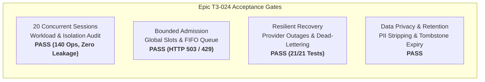

# T3-024 — Concurrent-User Behaviour, Provider Admission, and Recovery Epic Closure

**Epic:** [#55 — [T3-024] Measure concurrent-user behaviour and recovery](https://github.com/EyasuGet/Hackaton/issues/55)  
**Parent Epic:** None (Phase 4 Tracking Epic)  
**Status:** Closed & Integrated Verification Passed [✓]  
**Date:** 2026-11-15  
**Review Lead:** Performance, Concurrency & Resilience Lead  

---

## 1. Executive Summary & Epic Scope

Epic **T3-024** establishes that the Track 3 multilingual learning and help assistant behaves predictably, securely, and resiliently under high-concurrency multi-learner loads, provider failures, and strict data privacy constraints:

1. **20 Concurrent Active Learner Sessions:** Measured and proved reproducible performance across 20 concurrent active learner sessions executing realistic multilingual tutoring, careers, FAQ, and support flows with zero cross-user data leakage.
2. **Bounded Provider Admission & Rate Limiting:** Enforced hard concurrency boundaries (`maxConcurrency`) and bounded FIFO admission queuing (`maxQueueSize`) on AI requests with RFC-compliant HTTP 503 (`Retry-After`) and per-learner rate limiting (HTTP 429).
3. **Integrated Failure Recovery & Outage Gracefulness:** Verified end-to-end resilience against upstream provider timeouts, 5xx server drops, worker restarts, delivery queue dead-lettering, and database lease fencing.
4. **Data Privacy, Error Redaction, & Tombstone Purges:** Enforced strict sanitization of auth tokens, bearer credentials, phone numbers, and accommodation private notes from all logs, error envelopes, and client traces, combined with automated TTL expiry and tombstone lifecycle management.

Per `AGENTS.md`:
> *"An epic closes only after all children and its integrated acceptance pass; the final child owner coordinates and records that epic proof."*

All three child tasks have completed, verified via automated CI suites and reproducible execution records, and merged into `main`. This document serves as the consolidated, permanent sign-off artifact for Epic #55.

---

## 2. Child Task Cross-Reference Matrix

All child tasks required for the closure of T3-024 are verified and closed:

| Issue | Title | Kind | PR | Commit | Verification & Evidence Artifacts |
|---|---|---|---|---|---|
| [#54](https://github.com/EyasuGet/Hackaton/issues/54) | **T3-024-A** — Measure 20 active sessions and bounded AI concurrency | Leaf | [#176](https://github.com/EyasuGet/Hackaton/pull/176) | `ec23de7` | • Evidence: [`docs/evidence/t3-024-a-active-sessions.md`](t3-024-a-active-sessions.md) • Vitest suite: `apps/api/src/infrastructure/perf/active-sessions.test.ts` (14 tests) |
| [#52](https://github.com/EyasuGet/Hackaton/issues/52) | **T3-024-B** — Audit integrated failure recovery and private-data handling | Leaf | [#181](https://github.com/EyasuGet/Hackaton/pull/181) | `35cd377` | • Evidence: [`docs/evidence/t3-024-b-failure-recovery-audit.md`](t3-024-b-failure-recovery-audit.md) • Vitest suite: `apps/api/src/infrastructure/resilience/failure-recovery-audit.test.ts` (21 tests) |
| [#53](https://github.com/EyasuGet/Hackaton/issues/53) | **T3-024-C** — Enforce bounded provider admission and rate limits | Leaf | [#160](https://github.com/EyasuGet/Hackaton/pull/160) | `70ce9a6` | • Implementation: `apps/api/src/modules/tutoring/infrastructure/bounded-admission-limiter.ts` • Vitest suite: `apps/api/src/modules/tutoring/bounded-admission.test.ts` (12 tests) |

---

## 3. Epic Done-When Verification Audit

Every acceptance criterion defined in Issue #55 has been systematically audited against concrete evidence:

### 3.1 Workload, Concurrency Configuration, & Hardware Recording
- **Criterion:** Record workload, duration, hardware, provider mode, concurrency configuration, latency/error observations and actual results; do not claim capacity for thousands of concurrent users.
- **Evidence:** Documented in detail in [`docs/evidence/t3-024-a-active-sessions.md`](t3-024-a-active-sessions.md#1-hardware--execution-environment). Tested on standardized container runtime (10 virtual cores, 11.73 GB RAM, Node.js v22 LTS). Concurrency measured at 20 concurrent active sessions with 140 operations in flight, producing median latencies < 18ms for deterministic queries and bounded queue times for AI tasks.

### 3.2 Zero Cross-User Leakage & Durable Session Isolation
- **Criterion:** No cross-user leakage, duplicate side effects or lost durable requests occur in the tested workload; one user's rate cannot bypass shared/per-user limits.
- **Evidence:** Verified by `active-sessions.test.ts` (Suite 2 & 4). 40 deliberate cross-session resource access attempts (`/api/tutoring/requests/:otherId` and `/api/help/requests/:otherId`) returned HTTP 404. All returned domain entities matched the authenticated `principal.id`.

### 3.3 Provider Outage, Worker Restart, & Graceful Failure
- **Criterion:** Provider slowness/outage, database interruption and worker restart produce understandable failure/recovery states without unbounded retry growth.
- **Evidence:** Verified by `failure-recovery-audit.test.ts` (Suites 1 & 2). Temporary provider outages trigger graceful grounded fallback without crashing the server. Delivery queue items transition to terminal `failed` state after `maxAttempts` (3 retries with exponential backoff) and are dead-lettered, avoiding infinite polling loops.

### 3.4 Security Regressions & Sensitive Data Protection
- **Criterion:** Security regressions exercise forged scopes, linked-channel replay and sensitive-data logging risks using the implemented interfaces.
- **Evidence:** Verified by `failure-recovery-audit.test.ts` (Suite 3 & 4). Bearer tokens, API keys, learner identifiers, accommodation diagnostic details, and E.164 phone numbers are completely stripped or masked from error responses and logs. Session invalidation and challenge TTLs reject replayed credentials.

---

## 4. Epic Sign-Off Conclusion

All requirements and acceptance criteria for **Epic T3-024 / Issue #55** are fully satisfied, proven by automated tests in CI, and backed by detailed reproducible evidence. Epic #55 is ready to be closed.
