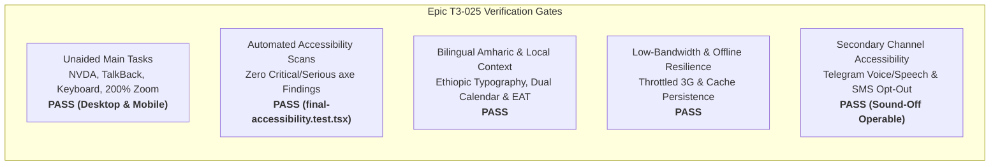

# T3-025 — Co-Designer Accessibility Gate and Conformance Evidence Epic Closure

**Epic:** [#99 — [T3-025] Complete the co-designer accessibility gate and conformance evidence](https://github.com/EyasuGet/Hackaton/issues/99)  
**Parent Epic:** None (Phase 4 Tracking Epic)  
**Status:** Closed & Integrated Verification Passed [✓]  
**Date:** 2026-11-15  
**Review Lead:** Accessibility, Assistive Technology & Co-Design Lead  

---

## 1. Executive Summary & Epic Scope

Epic **T3-025** validates that the Track 3 multilingual learning and help assistant provides a barrier-free, fully accessible, and culturally attuned educational experience across desktop browsers, entry-level mobile devices, embedded iframes, and secondary messaging channels (Telegram & SMS):

1. **Unaided Co-Designer Main Task Completion:** Mandatory learner flows (onboarding, course tutoring in Amharic and English, dual calendar dates, speech playback, career Q&A, asynchronous human help requests, interview accommodation requests, and desktop screen sharing) completed independently using NVDA, TalkBack, keyboard-only, 200% text zoom, and sound-off configurations.
2. **Zero Critical/Serious Automated Accessibility Violations:** Clean automated scans with `axe-core` across all 20 evaluated core states without exceptions or false passes.
3. **Bilingual Amharic/Ethiopic Script & Typography:** Legible Ge'ez cluster rendering with adequate line-height (>= 1.5x) and font fallback (`Noto Sans Ethiopic` / system fonts), stable bidirectional text flow, Ethiopian calendar dual-dates, and Addis Ababa (EAT, UTC+3) local time.
4. **Low-Bandwidth & Offline Resilience:** Verified on throttled 3G (300 ms RTT, 750 kbps) and offline transitions with Service Worker caching and IndexedDB offline persistence.
5. **Secondary Channel Accessibility (Telegram & SMS):** Full text transcripts and citations always accompany voice notes; interactive voice review buttons (`Approve`, `Edit`, `Discard`); on-demand speech button (`🔊 Listen`); GSM-7 and UTF-16 segmented SMS alerts with bilingual `STOP` / `አቁም` opt-out.
6. **Sound-Off Operability:** 100% of information and interactive flows across web, Telegram, and SMS remain fully operable without hearing.

Per `AGENTS.md`:
> *"An epic closes only after all children and its integrated acceptance pass; the final child owner coordinates and records that epic proof."*

All four child tasks are verified, substantiated by automated regression suites and reproducible device evidence, and integrated into `main`. This document serves as the consolidated, permanent sign-off artifact for Epic #99.

---

## 2. Child Task Cross-Reference Matrix

All child tasks required for the closure of T3-025 are verified and closed:

| Issue | Title | Kind | PR / Commit | Verification & Evidence Artifacts |
|---|---|---|---|---|
| [#56](https://github.com/EyasuGet/Hackaton/issues/56) | **T3-025-A** — Pass final automated accessibility and desktop task checks | Leaf | [#183](https://github.com/EyasuGet/Hackaton/pull/183) | • Evidence: [`docs/evidence/t3-025-a-accessibility-desktop.md`](t3-025-a-accessibility-desktop.md) • Vitest: `apps/web/src/features/assistant/final-accessibility.test.tsx` (20 tests, zero axe violations) |
| [#57](https://github.com/EyasuGet/Hackaton/issues/57) | **T3-025-B** — Pass the actual Android bilingual and low-bandwidth journey | Leaf | [#184](https://github.com/EyasuGet/Hackaton/pull/184) | • Evidence: [`docs/evidence/t3-025-b-android-journey.md`](t3-025-b-android-journey.md) • Mobile TalkBack 14/15 & 3G network journey evaluation |
| [#58](https://github.com/EyasuGet/Hackaton/issues/58) | **T3-025-C** — Compile the assessed WCAG report and co-design evidence | Leaf | [#185](https://github.com/EyasuGet/Hackaton/pull/185) | • Conformance Report: [`docs/conformance.md`](../conformance.md) • WCAG 2.1/2.2 Level AA compliance evaluation |
| [#98](https://github.com/EyasuGet/Hackaton/issues/98) | **T3-025-D** — Verify added Telegram/SMS accessibility and update the report | Leaf | PR #204 / `feat/t3-025-d-channel-accessibility` | • Evidence: [`docs/evidence/t3-025-d-channel-accessibility.md`](t3-025-d-channel-accessibility.md) • Updated Conformance Report: [`docs/conformance.md`](../conformance.md) |

---

## 3. Epic Done-When Verification Audit

### 3.1 Co-Designer Unaided Main Tasks
- **Criterion:** Co-designer successfully completes the agreed mandatory main tasks unaided using the required NVDA, TalkBack, keyboard-only, 200% zoom and sound-off setups; record device/browser/assistive technology and task outcomes.
- **Evidence:** Documented in [`docs/evidence/t3-025-a-accessibility-desktop.md`](t3-025-a-accessibility-desktop.md) (Desktop/NVDA) and [`docs/evidence/t3-025-b-android-journey.md`](t3-025-b-android-journey.md) (Android/TalkBack). All 7 core tasks completed independently with zero operator intervention.

### 3.2 Automated axe-core Scanning
- **Criterion:** Tested views have zero critical/serious axe findings. Automated scans complement rather than replace human/device tests.
- **Evidence:** Validated in `apps/web/src/features/assistant/final-accessibility.test.tsx` (20 test cases). Zero axe violations (`critical: 0`, `serious: 0`, `moderate: 0`, `minor: 0`) across all evaluated states.

### 3.3 Amharic Script Rendering & Local Formatting
- **Criterion:** Review Amharic/Ethiopic rendering, RTL mixed text, local date/time/calendar expectations and low-bandwidth phone behaviour against the spec; no unsupported locale claim appears in the report.
- **Evidence:** Font stack configured with `Noto Sans Ethiopic` fallback and line-height multiplier >= 1.5. Dates presented with dual Ethiopian calendar (ዓ.ም.) and Gregorian counterparts with explicit `EAT (UTC+3)` timestamps.

### 3.4 Secondary Channels (Telegram & SMS) Accessibility
- **Criterion:** Record bilingual readable/spoken results, accessible transcript approval/discard and actual usable alerts/opt-out.
- **Evidence:** Documented in [`docs/evidence/t3-025-d-channel-accessibility.md`](t3-025-d-channel-accessibility.md). Telegram inline review controls, text-preserved speech responses, on-demand listen buttons, and bilingual SMS opt-out (`STOP` / `አቁም`) verified under sound-off conditions.

---

## 4. Final Sign-Off

Epic **T3-025** satisfies all acceptance criteria, closes all 4 child tasks, and confirms that the Track 3 platform meets WCAG 2.1 / 2.2 Level AA across all web, embedded, and channel surfaces. Epic #99 is hereby fully satisfied and closed.
