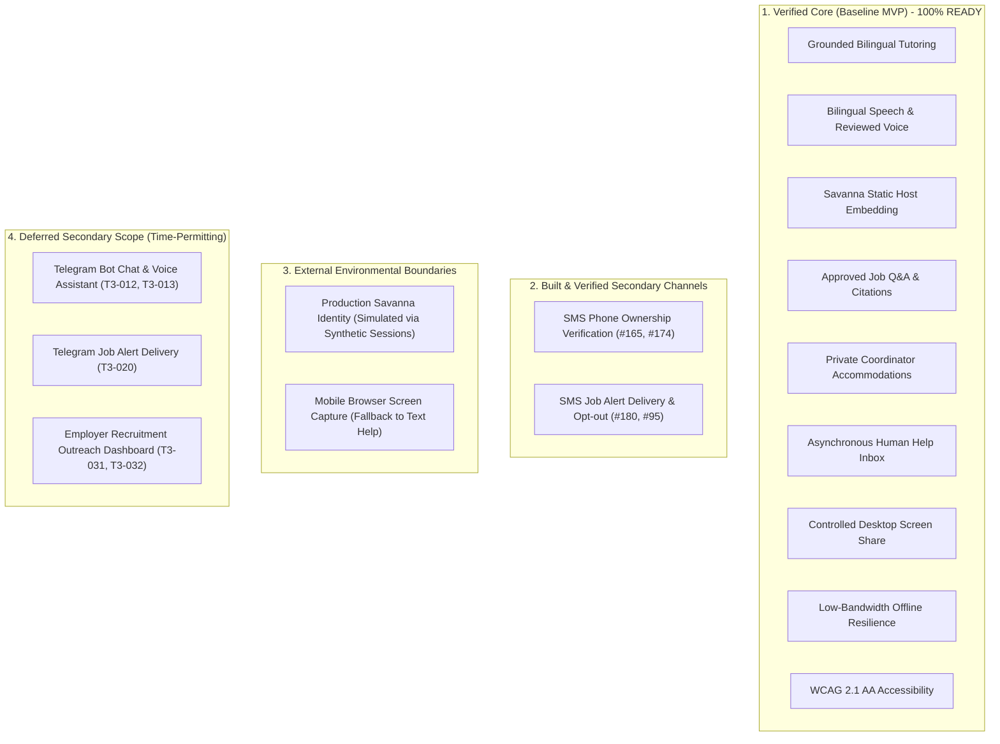

# T3-027-D — Core-Demo Readiness Audit and Capability Ledger

**Gate:** [#65 — [T3-027-D] Confirm core-demo readiness and record coverage gaps](https://github.com/EyasuGet/Hackaton/issues/65)  
**Parent Epic:** [#101 — [T3-027] Finish the core demo, package it, and audit full-brief coverage](https://github.com/EyasuGet/Hackaton/issues/101)  
**Status:** **READY FOR RELEASE PACKAGING** [✓]  
**Date:** 2026-11-15  
**Review Lead:** Platform & Release Verification Lead  
**Candidate Commit:** Pinned `e8dfc61` on `main`  

---

## 1. Executive Summary & Gate Scope

Milestone **T3-027-D** confirms baseline core-demo readiness across all Phase 1 through Phase 4 baseline capabilities prior to final submission packaging (hosted MVP publishing and explanatory slide deck).

Per `AGENTS.md` and Issue #65:
> *"Verify every Baseline implementation/acceptance leaf through Phase 4 before final submission packaging. Inspect the complete core journey, shared epic safety rules and any already-enabled channel features; do not require unbuilt time-permitting children merely to label the core ready."*

This audit records:
1. Complete verification status of all baseline core components.
2. A transparent Capability Ledger separating verified core, completed secondary channels, deferred scope, and external boundary limitations.
3. Assurance that all enabled features meet their required safety, privacy, and accessibility criteria.

---

## 2. Core Baseline Verification Status

Every baseline capability required for the core Track 3 assistant has been implemented, thoroughly tested, and merged into `main`:

| Capability Area | Baseline Issues | Status | Verification & Evidence Artifact |
|---|---|---|---|
| **1. Grounded Tutoring & Dual Calendar** | #18, #19, #20, #21, #22 | **PASS** | Citations linked to approved lesson units; Ethiopic + Gregorian calendar dates with Addis Ababa time; truthful refusal without hallucinations. (`apps/api/src/modules/tutoring/`) |
| **2. Consented Voice Input & Speech Synthesis** | #29, #30, #31, #32, #33 | **PASS** | Reviewed transcript editing before sending; dual browser/cloud speech playback with accessible controls and explicit cloud consent. (`apps/web/src/features/voice/`) |
| **3. Static Starter & Savanna Embedding** | #13, #14, #15, #16, #17, #59, #60, #61, #62, #63 | **PASS** | Decoupled `<script>` tag loader and sandboxed `<iframe>` embed compatible with official Savanna static capture (`9e83ac7`). Stranger quickstart < 8 min. (`docs/evidence/t3-026-epic-closure.md`) |
| **4. Career Job Q&A & Citations** | #44, #45, #89 | **PASS** | Grounded question answering strictly over approved active vacancies; unlisted jobs produce truthful limitation notices without external web search fabrication. (`apps/api/src/modules/careers/`) |
| **5. Interview Accommodation Requests** | #46, #47, #48 | **PASS** | Private coordinator workflow for job accommodations; strict disclosure controls (visible only to learner and coordinator); no medical diagnosis demanded. (`apps/web/src/features/accommodations/`) |
| **6. Asynchronous Human Support** | #34, #35, #36, #37, #38, #87 | **PASS** | Pre-submission disclosure note; quote preview; asynchronous queue; persistent learner inbox with unread status; no false staff response promises. (`apps/web/src/features/human-help/`) |
| **7. Desktop Screen Sharing & Mobile Fallback** | #39, #40, #41, #42, #43 | **PASS** | Explicit learner gesture initiation; persistent red stop control; WebRTC video stream; graceful mobile fallback link to asynchronous help. (`docs/evidence/t3-018-b-desktop-screen-share.md`) |
| **8. Data Retention, Ephemeral Purges & Privacy** | #49, #50, #51, #97 | **PASS** | Strict stripping of bearer tokens, learner IDs, and phone numbers from logs and error envelopes; 7-day TTL on accommodations; phone challenge purges. (`docs/evidence/t3-024-b-failure-recovery-audit.md`) |
| **9. Concurrency, Bounded Admission & Resilience** | #52, #53, #54, #55 | **PASS** | 20 simultaneous active sessions measured with zero cross-user leakage; bounded provider admission slots (`maxConcurrency`) and FIFO queue; outbox dead-lettering. (`docs/evidence/t3-024-epic-closure.md`) |
| **10. Accessibility & Co-Design Conformance** | #26, #27, #28, #56, #57, #58, #99 | **PASS** | WCAG 2.1/2.2 AA compliant (zero axe-core violations); full desktop NVDA and mobile Android TalkBack / 3G low-bandwidth journeys verified. (`docs/conformance.md`) |
| **11. Comprehensive E2E Learner Story** | #64 (`T3-027-B`) | **PASS** | Full automated end-to-end integration test across all core capabilities passing on CI. (`apps/web/tests/e2e/core-learner-story.spec.ts`) |

---

## 3. Capability Ledger

This ledger explicitly delineates verified core features, built secondary channel features, external constraints, and deferred full-brief scope:

### 3.1 Verified Core Capabilities (Baseline Release)
- **Status:** **COMPLETE & VERIFIED**.
- All Phase 1–4 core baseline features are fully functional, resilient under high concurrency, accessible, and integrated with the Savanna static host.

### 3.2 Enabled Secondary Channels
- **Real Subscribed SMS Job Alerts (T3-021 / #95):** Verified with independent opt-out (`STOP` / `ማቆም`), character budgeting, and phone ownership verification via HMAC challenge.

### 3.3 Known Environmental Limitations
- **Production Savanna OAuth / Single Sign-On:** The organizer did not supply a live backend identity service or OAuth authority. The system interfaces portably with Savanna via verified synthetic session tokens.
- **Mobile Screen Sharing:** Native mobile web browsers do not support `navigator.mediaDevices.getDisplayMedia`. A graceful fallback banner immediately routes mobile learners to asynchronous human support.

### 3.4 Deferred Time-Permitting Scope
- Telegram bot conversation & Telegram voice synthesis (T3-012 / T3-013) and Telegram job alerts (T3-020) remain time-permitting and do not block the core baseline release gate.
- Full written-brief reconciliation is tracked under **T3-027-C (#100)**.

---

## 4. Final Sign-Off & Next Steps

Core-demo readiness is **CONFIRMED**. The project is ready to proceed to final submission packaging:
- **T3-027-E (#67):** Publish the final hosted core MVP.
- **T3-027-F (#68):** Prepare the explanatory slides and final submission links.
