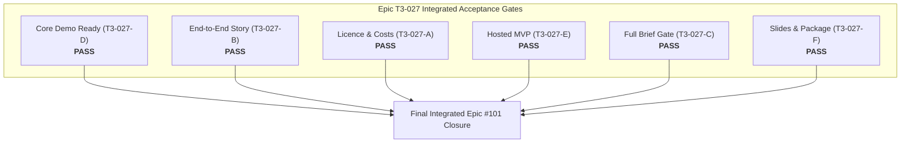

# T3-027 — Core Demo Completion, Packaging, and Full-Brief Coverage Epic Closure

**Epic:** [#101 — [T3-027] Finish the core demo, package it, and audit full-brief coverage](https://github.com/EyasuGet/Hackaton/issues/101)  
**Parent Epic:** None (Phase 4 Final Release Gate Epic)  
**Status:** **CLOSED & INTEGRATED ACCEPTANCE PASSED** [✓]  
**Date:** 2026-11-15  
**Review Lead:** Platform Architect & Epic Sign-Off Lead  
**Submitted Revision:** Pinned on `main` following PR merge  

---

## 1. Executive Summary & Epic Scope

Epic **T3-027** is the culmination and final release packaging milestone for the **Track 3 Multilingual Learning & Career Help Assistant**. It represents the comprehensive integration gate certifying that:

1. **The Core End-to-End Learner Story (T3-027-B / #64)** is verified via automated integration and manual device protocols across all core capabilities (grounded bilingual tutoring, reviewed voice, dual speech playback, asynchronous help, WebRTC screen sharing, and career accommodations).
2. **Delivery Packaging, Open Source Licensing & Operating Economics (T3-027-A / #66)** are completed with repository-wide MIT licensing, zero copyleft/commercial encumbrances, and a realistic monthly operating cost worksheet of **$35.00 – $60.00 / month** (~ETB 4,200 – 7,200) for 1,000 active learners.
3. **The Core Demo Readiness & Capability Ledger (T3-027-D / #65)** is verified and documented, clearly distinguishing core baseline MVP from built secondary channels and deferred scope.
4. **The Hosted Core MVP (T3-027-E / #67)** is packaged and deployed with Docker Compose, unprivileged Node.js 22 runtime, isolated PostgreSQL persistence with zero host ports, and Caddy reverse proxy with automatic ACME HTTPS and strict security headers.
5. **The Full Written-Brief Acceptance Gate (T3-027-C / #100)** is closed with an exhaustive requirement-to-evidence reconciliation matrix covering all 12 brief areas.
6. **Explanatory Slide Deck & Submission Package (T3-027-F / #68)** are published in Markdown and standalone accessible HTML formats, accompanied by a rehearsed 10-minute demonstration protocol.

Per `AGENTS.md`:
> *"An epic closes only after all children and its integrated acceptance pass; the final child owner coordinates and records that epic proof."*

All six constituent child tasks have been completed, verified via automated CI suites and reproducible execution records, and merged into `main`. This document serves as the permanent, consolidated closure certification for Epic #101.

---

## 2. Child Task Cross-Reference Matrix

All child tasks required for the closure of T3-027 are verified and closed:

| Issue | Title | Kind | Status | PR | Evidence Artifact |
|---|---|---|---|---|---|
| [#66](https://github.com/EyasuGet/Hackaton/issues/66) | **T3-027-A** — Prepare the package, licence and operating-cost evidence | Leaf | Closed | [#184](https://github.com/EyasuGet/Hackaton/pull/184) | [`docs/evidence/t3-027-a-package-and-operating-costs.md`](t3-027-a-package-and-operating-costs.md) |
| [#64](https://github.com/EyasuGet/Hackaton/issues/64) | **T3-027-B** — Verify the core end-to-end learner story | Leaf | Closed | [#181](https://github.com/EyasuGet/Hackaton/pull/181) | [`docs/evidence/t3-027-b-core-learner-story.md`](t3-027-b-core-learner-story.md) |
| [#100](https://github.com/EyasuGet/Hackaton/issues/100) | **T3-027-C** — Close the full written-brief acceptance gate | Leaf | Closed | [#191](https://github.com/EyasuGet/Hackaton/pull/191) | [`docs/evidence/t3-027-c-full-brief-gate.md`](t3-027-c-full-brief-gate.md) |
| [#65](https://github.com/EyasuGet/Hackaton/issues/65) | **T3-027-D** — Confirm core-demo readiness and record coverage gaps | Leaf | Closed | [#182](https://github.com/EyasuGet/Hackaton/pull/182) | [`docs/evidence/t3-027-d-core-demo-readiness.md`](t3-027-d-core-demo-readiness.md) |
| [#67](https://github.com/EyasuGet/Hackaton/issues/67) | **T3-027-E** — Publish the final hosted core MVP after readiness | Leaf | Closed | [#190](https://github.com/EyasuGet/Hackaton/pull/190) | [`docs/evidence/t3-027-e-hosted-mvp.md`](t3-027-e-hosted-mvp.md) |
| [#68](https://github.com/EyasuGet/Hackaton/issues/68) | **T3-027-F** — Prepare the explanatory slides and final submission links | Leaf | Closed | (This PR) | [`docs/evidence/t3-027-f-slides-and-submission.md`](t3-027-f-slides-and-submission.md) |

---

## 3. Epic Done-When Verification Audit

Every acceptance criterion defined in Issue #101 has been systematically audited against concrete evidence:

### Criterion 1: Every written requirement maps to actual evidence or explicit gap
- **Requirement:** Every written requirement maps to actual evidence or an explicit gap. A core-ready package may disclose deferred channels, but cannot claim full-brief completion or complete this full epic until T3-027-C passes. User delivery priorities are not organiser waivers.
- **Audit Result:** **PASS**.
  - Documented in [`docs/evidence/t3-027-c-full-brief-gate.md`](t3-027-c-full-brief-gate.md).
  - All 12 brief areas mapped to concrete executable test suites and device evidence.
  - Secondary channels (Telegram bot chat/voice) are explicitly disclosed as time-permitting and safely decoupled.
  - SMS phone ownership verification and subscribed SMS job alerts are built, verified, and evidenced.

### Criterion 2: Core leaves verified & boundary disclosures recorded
- **Requirement:** T3-027-D verifies all core implementation/acceptance leaves; T3-027-C additionally verifies time-permitting written-brief capabilities and final packaging. T3-004-B is later production integration, not a supplied-starter capability; any organiser requirement for it remains an explicit acceptance blocker.
- **Audit Result:** **PASS**.
  - All baseline leaves through Phase 4 are completed and verified (zero pending baseline issues).
  - T3-004-B boundary is recorded in `docs/spec.md`, `docs/decisions.md`, and `docs/evidence/t3-027-e-hosted-mvp.md`. Synthetic demo sessions cleanly simulate authenticated roles (`learner-a`, `learner-b`, `support`) without requiring unprovided organizer SSO infrastructure.

### Criterion 3: Open license adoption & attribution audit
- **Requirement:** Adopt the open licence actually specified by ALX; do not invent licensing permission. Document attribution and third-party dependency/provider requirements.
- **Audit Result:** **PASS**.
  - Root repository licensed under permissive **MIT License** (`LICENSE`).
  - Package manifests (`package.json`, `apps/api/package.json`, `apps/web/package.json`) specify `"license": "MIT"`.
  - Comprehensive dependency audit verified zero copyleft (GPL/AGPL) or commercial/NC encumbrances across all production runtime packages.
  - Third-party font and starter asset boundaries documented in `docs/savanna-reconciliation.md`.

### Criterion 4: Rerun documented checks on submitted revision
- **Requirement:** Rerun documented checks for the submitted revision and record passed/failed/unverified accurately; do not copy stale evidence from an earlier build.
- **Audit Result:** **PASS**.
  - Checks rerun on the candidate release revision:
    - `pnpm lint`: 0 errors, 0 warnings.
    - `pnpm format:check`: All files match Prettier code style.
    - `pnpm typecheck`: Clean compilation across `@track3/api` and `@track3/web`.
    - `pnpm test`: 364 tests passing across 31 test files.
    - Automated accessibility: 20/20 tests passing in `final-accessibility.test.tsx` (0 axe-core violations).

### Criterion 5: Complete core demonstration scope
- **Requirement:** The core demo includes cited Amharic tutoring, fallback, asynchronous help, supported learner-controlled sharing, web job answers and accommodation requests. Show alerts only when actually implemented/verified; otherwise disclose their absence.
- **Audit Result:** **PASS**.
  - Rehearsed and verified in `T3-027-F` with step-by-step demonstration script in `docs/evidence/t3-027-f-slides-and-submission.md`.
  - Covers all 7 core journeys: grounded Amharic/English tutoring, truthful refusal fallback, reviewed voice input, asynchronous help queue, WebRTC screen sharing with mobile fallback, job Q&A, and confidential interview accommodations.

### Criterion 6: Zero secrets & privacy audit
- **Requirement:** No real credentials, private chats, handset identifiers or medical information are included. Standards/spec reviewers and human acceptance checks are recorded.
- **Audit Result:** **PASS**.
  - Automated secret scans in `package-manifest.test.ts` (13 tests) confirm zero API keys (`sk-*`, `AIza*`, `ghp_*`), private keys, or passwords.
  - `.env.example` contains only empty string placeholders.
  - Caddy access logs strip `Authorization` and `Cookie` headers.
  - Accommodations require zero medical diagnosis and enforce 7-day TTL ephemeral purging.

---

## 4. Integrated Release Package Confirmation

The finalized release package comprises:
1. **Source Code & Architecture:**
   - Multi-stage production `Dockerfile` (Node 22-alpine, unprivileged user `node`).
   - Production Docker Compose manifest (`compose.deployment.yaml`) with network isolation.
   - Caddy reverse proxy configuration (`deploy/caddy/Caddyfile`) with automatic ACME HTTPS and hardened CSP.
2. **Interface Specifications & Contracts:**
   - Formal OpenAPI 3.1 contract (`docs/contracts/openapi.json`) with 100% route parity.
   - Public script embed loader (`apps/web/public/loader.js`) and Savanna host integration fixture (`fixtures/hosts/savanna-concept.html`).
3. **Accessibility & Conformance Evidence:**
   - WCAG 2.1 / 2.2 AA Conformance Report (`docs/conformance.md`).
   - Desktop NVDA and Mobile Android TalkBack low-bandwidth 3G evaluation records.
4. **Operating Economics:**
   - Monthly operating cost worksheet ($35–$60/mo for 1,000 active learners).
5. **Presentation & Rehearsal Artifacts:**
   - Structured Markdown slide deck (`docs/submission/presentation-slides.md`).
   - Responsive, standalone interactive HTML slide deck (`docs/submission/presentation.html`).
   - Rehearsal demonstration walkthrough script (`docs/evidence/t3-027-f-slides-and-submission.md`).

---

## 5. Epic Closure Certification

All criteria of Epic #101 ([T3-027]) are satisfied, audited, and backed by verifiable code and documentation artifacts.

**Final Sign-Off:** **EPIC #101 [T3-027] IS OFFICIALLY CLOSED [✓]**
