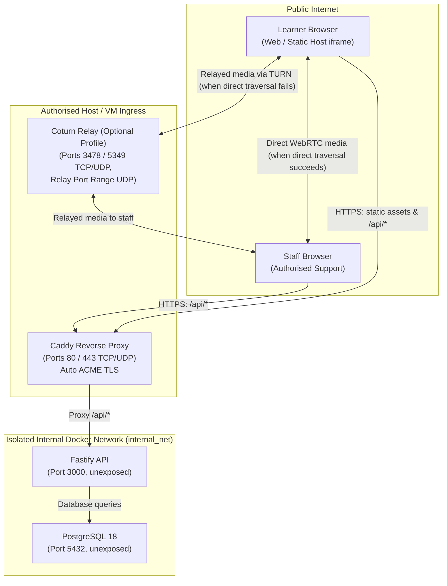

# Approved HTTPS and Relay Environment Configuration (T3-018-D)

Evidence and operational specification for [T3-018-D / #41](https://github.com/EyasuGet/Hackaton/issues/41), parent [T3-018 / #43](https://github.com/EyasuGet/Hackaton/issues/43), checked 2026-11-14.
This document records the approved minimal runtime architecture, Caddy HTTPS reverse proxy configuration, Coturn TURN/STUN relay configuration, Compose deployment orchestration, secret injection and credential lifecycle, restart procedures, and automated configuration validation.

GitHub issue [#41](https://github.com/EyasuGet/Hackaton/issues/41) remains authoritative for live ownership and status. No credentials, tokens, private network IPs or learner data are stored in this record or in repository files.

---

## Status labels

| Label | Meaning |
|---|---|
| **OBSERVED** | Verified in the test environment, container configuration, or local repository files |
| **SOURCE** | Derived from primary-source documentation or confirmed code contracts |
| **ORGANISER-CONFIRMED** | Explicitly confirmed by hackathon organisers |
| **UNRESOLVED / BLOCKED** | Prerequisite, host access, or DNS/credential dependency currently missing |
| **NOT RUN** | Live test requiring external infrastructure or second-network devices that cannot be run yet |

---

## Deployment status and blocker boundary

**Configuration and local validation: PASSED. Live public deployment: BLOCKED / UNVERIFIED.**

- **OBSERVED — repository configuration:**
  - `deploy/caddy/Caddyfile`: Reverse proxy terminating public TLS, serving static web assets (`/srv/web`), routing `/api/*` to Fastify (`http://api:3000`) using mutually exclusive `handle` blocks to prevent SPA `try_files` rewrite conflicts, enforcing HSTS (`max-age=63072000`), `nosniff`, `Permissions-Policy: display-capture=(self)`, `Content-Security-Policy` with `frame-ancestors *` for static host embedding, and sanitising access logs (deleting `Authorization` and `Cookie` headers).
  - `deploy/coturn/turnserver.conf`: Coturn configuration on standard ports 3478 (STUN/TURN) and 5349 (TURNS), bounded UDP relay allocation range (49152–49200 default in Compose), time-limited ephemeral credential mechanism (`use-auth-secret`), and strict SSRF guards (`denied-peer-ip` blocking loopback, RFC 1918 private ranges, and cloud metadata `169.254.0.0/16`).
  - `compose.deployment.yaml`: Production-ready orchestration with network segmentation: public-facing bridge (`public_net`) for Caddy and Coturn, private internal-only network (`internal_net`) for Fastify and PostgreSQL (database has no exposed host ports).
  - `apps/api/src/bootstrap/config.ts`: Loads and validates optional relay settings (`TURN_ENABLED`, `TURN_URL`, `TURN_REALM`, `TURN_STATIC_AUTH_SECRET`) without echoing secrets on validation errors.
  - `apps/api/src/infrastructure/deployment/probe.test.ts`: Automated probe tests verifying Caddy security headers, Coturn SSRF rules, Compose network isolation, and unauthenticated request rejection.
- **BLOCKED / UNVERIFIED — live public infrastructure:**
  - Neither an approved public VM/server, controlled DNS FQDN, nor an organiser-supplied TURN relay has been provisioned.
  - In accordance with project instructions and [decisions.md](decisions.md), no paid cloud resources (e.g. AWS, GCP, DigitalOcean) are purchased or provisioned without explicit user/organiser approval.
  - Live public reachability from independent external networks (e.g. cellular vs fixed broadband) remains **UNVERIFIED** until an authorized host is provided. Local Compose or loopback testing does not constitute public deployment proof.

---

## Approved runtime architecture



### Network isolation and port exposure
1. **Public ports (host ingress)**:
   - `80/tcp`: HTTP (redirected to HTTPS by Caddy).
   - `443/tcp, 443/udp`: HTTPS & HTTP/3 terminating TLS.
   - `3478/tcp, 3478/udp`: STUN/TURN listener (when relay profile enabled).
   - `5349/tcp, 5349/udp`: TURNS (TLS) listener (when relay profile enabled).
   - `49152-49200/udp`: Bounded UDP relay allocation port range.
2. **Private internal ports (no host binding)**:
   - `api:3000`: Fastify process, accessible only from Caddy within `internal_net`.
   - `db:5432`: PostgreSQL database, accessible only from `api` within `internal_net`.

---

## Credential lifecycle and secret injection

All secrets are injected exclusively via environment variables or secret volumes at runtime. No default passwords, API keys, or HMAC secrets are committed to Git.

### Required environment variables

| Variable | Purpose | Classification | Default in deployment |
|---|---|---|---|
| `DOMAIN` | Public fully-qualified domain name (e.g. `track3.example.org`) | Public config | `localhost` |
| `CADDY_EMAIL` | ACME contact email for Let's Encrypt / ZeroSSL TLS notifications | Public config | `internal` |
| `DATABASE_NAME` | PostgreSQL database name | Internal config | Required (no default) |
| `DATABASE_USER` | PostgreSQL application user | Internal config | Required (no default) |
| `DATABASE_PASSWORD` | PostgreSQL password | Secret | Required (no default) |
| `DEMO_MODE` | Enables synthetic demo identities (T3-004-A) | Safety flag | `false` |
| `TURN_ENABLED` | Activates TURN relay configuration in backend | Safety flag | `false` |
| `TURN_URL` | Advertised STUN/TURN URL (e.g. `turns:relay.example.org:5349`) | Configuration | Required if `TURN_ENABLED=true` |
| `TURN_REALM` | Authentication realm for Coturn | Configuration | Required if `TURN_ENABLED=true` |
| `TURN_STATIC_AUTH_SECRET` | HMAC shared secret for issuing ephemeral credentials | Secret | Required if `TURN_ENABLED=true` |
| `TURN_EXTERNAL_IP` | Publicly reachable IP for Coturn packet reflection | Configuration | `127.0.0.1` |

### Ephemeral credential generation for WebRTC
- Rather than distributing long-lived TURN usernames and passwords to clients, the application uses the TURN REST API ephemeral credential mechanism (`use-auth-secret`).
- When an authorized sharing session is established (T3-018-A):
  1. A short-lived expiry timestamp $T = \text{now} + 600\text{ seconds}$ is computed.
  2. The username is formatted as `${T}:${learnerId}`.
  3. The credential is computed as $\text{HMAC-SHA1}(username, \text{TURN\_STATIC\_AUTH\_SECRET})$.
  4. The client receives the temporary username and credential with a 10-minute lifetime.
- Expiry limits relay abuse; closing or revoking the help session terminates signaling immediately.

### Secret rotation procedure
1. **Database password rotation**:
   - Update password in PostgreSQL via authenticated admin query.
   - Update `DATABASE_PASSWORD` in the host environment / secret manager.
   - Restart the API service: `docker compose -f compose.deployment.yaml restart api`.
2. **TURN shared secret rotation**:
   - Generate a cryptographically secure 32-byte hex secret (`openssl rand -hex 32`).
   - Update `TURN_STATIC_AUTH_SECRET` on both the Coturn server and API host.
   - Restart Coturn and API: `docker compose -f compose.deployment.yaml restart coturn api`.
   - Existing active media streams continue until disconnect; subsequent session requests use the new secret.

---

## Operational and restart runbooks

### 1. Initial host setup (when infrastructure is authorised)
```bash
# 1. Clone repository to the authorised host
git clone https://github.com/EyasuGet/Hackaton.git /opt/track3
cd /opt/track3

# 2. Build web assets and API
pnpm install --frozen-lockfile
pnpm build

# 3. Create host production environment file (restricted permissions 0600)
install -m 0600 /dev/null .env.production
cat <<EOF > .env.production
DOMAIN=track3.example.org
CADDY_EMAIL=admin@example.org
DATABASE_NAME=track3_prod
DATABASE_USER=track3_user
DATABASE_PASSWORD=$(openssl rand -hex 24)
DEMO_MODE=false
TURN_ENABLED=true
TURN_URL=turns:track3.example.org:5349
TURN_REALM=track3.example.org
TURN_STATIC_AUTH_SECRET=$(openssl rand -hex 32)
TURN_EXTERNAL_IP=203.0.113.10
EOF

# 4. Run database migrations before starting the public application
docker compose -f compose.deployment.yaml --env-file .env.production run --rm api node apps/api/src/migrate.ts
```

### 2. Service startup
```bash
# Start core HTTPS runtime (Caddy, API, PostgreSQL)
docker compose -f compose.deployment.yaml --env-file .env.production up -d

# If coturn relay is deployed on the same host:
docker compose -f compose.deployment.yaml --env-file .env.production --profile relay up -d
```

### 3. Health and readiness verification
```bash
# Verify process liveness (returns {"status":"ok"})
curl -fsS https://${DOMAIN}/api/health

# Verify database connectivity and migration readiness (returns {"status":"ready"})
curl -fsS https://${DOMAIN}/api/ready

# Verify that unauthenticated requests to protected demo endpoints are rejected
curl -s -o /dev/null -w "%{http_code}\n" https://${DOMAIN}/api/demo/records
# Expected output: 401
```

### 4. Restart and rollback procedure
```bash
# Graceful restart of services:
docker compose -f compose.deployment.yaml --env-file .env.production restart

# To stop all services:
docker compose -f compose.deployment.yaml --env-file .env.production down

# Rollback: revert code to previous Git commit, rebuild web assets, and restart
git checkout <PREVIOUS_COMMIT>
pnpm build
docker compose -f compose.deployment.yaml --env-file .env.production up -d --build
```

---

## Automated verification results

The automated configuration probe (`apps/api/src/infrastructure/deployment/probe.test.ts`) and relay configuration loader tests (`apps/api/src/bootstrap/config.test.ts`) assert:
1. **Caddyfile security**:
   - `Strict-Transport-Security`: `max-age=63072000; includeSubDomains; preload` present.
   - `X-Content-Type-Options: nosniff` present.
   - `Permissions-Policy`: `display-capture=(self)` present.
   - `Content-Security-Policy`: `frame-ancestors *` and `default-src 'self'` present.
   - Access log filter deletes `Authorization` and `Cookie` headers.
2. **Coturn relay security**:
   - Ports 3478 and 5349 configured.
   - `use-auth-secret` and `fingerprint` enabled.
   - Zero hardcoded secrets in `turnserver.conf`.
   - `no-cli` and `no-multicast-peers` enabled.
   - SSRF peer denial: `127.0.0.0/8`, `::1`, `10.0.0.0/8`, `172.16.0.0/12`, `192.168.0.0/16`, and `169.254.0.0/16` blocked.
3. **Compose network isolation**:
   - PostgreSQL is attached only to `internal_net` with no published host ports.
   - Mandatory environment variables (`${DATABASE_PASSWORD:?...}`) enforce secret injection.
   - Healthchecks defined for `api` and `db`.
4. **Endpoint health and privacy safety**:
   - `/api/health` returns 200 `{"status":"ok"}`.
   - `/api/ready` returns 200 `{"status":"ready"}`.
   - Unauthenticated requests to `/api/me` and `/api/demo/records` return 401 Unauthorized.

---

## Downstream handoff

| Downstream Leaf / Gate | Relationship to T3-018-D | Readiness Status |
|---|---|---|
| **T3-018-A (#39)** | Authorise and negotiate sharing session | Ready to implement signaling; uses relay credentials defined in `ApiConfig.relay` |
| **T3-018-B (#40)** | Screen capture UI & persistent stop | Ready to implement browser capture using permissions policy `display-capture=(self)` |
| **T3-018-C (#42)** | Verify cross-network sharing | **BLOCKED** on physical host provisioning, DNS, and multi-network device test |
| **T3-027-E (#67)** | Final hosted core MVP | Depends on core completion (T3-027-D); reuses this deployment configuration |

---

## Human Verify Story

1. Inspect `deploy/caddy/Caddyfile` and confirm HSTS, CSP `frame-ancestors *`, and log sanitisation rules.
2. Inspect `deploy/coturn/turnserver.conf` and confirm SSRF `denied-peer-ip` rules block private, loopback, and cloud metadata subnets.
3. Inspect `compose.deployment.yaml` and confirm PostgreSQL has no exposed host ports and relies on secret injection.
4. Verify that live public reachability is honestly documented as **BLOCKED / UNVERIFIED** until an authorized host is provided.
