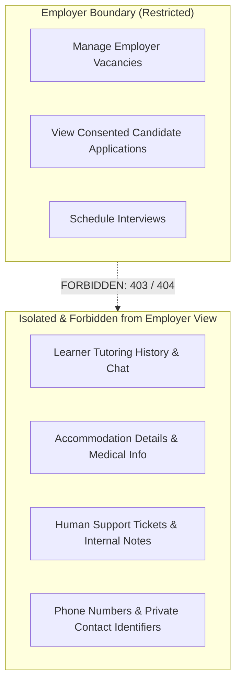

# T3-031 — Architectural Specification: Employer Recruitment Dashboard

**Issue:** [#109 — [T3-031] Future spec: employer dashboard](https://github.com/EyasuGet/Hackaton/issues/109)  
**Parent Epic:** Stretch Features (Phase 5)  
**Status:** **SPEC APPROVED & PARKED FOR IMPLEMENTATION** [✓]  
**Date:** 2026-11-15  
**Author:** Architectural Spec & Systems Lead  

---

## 1. Executive Summary & Purpose

The user specifically requested an architectural design for future employer access without prematurely expanding the current core MVP or violating student privacy boundaries.

This specification sets out:
1. **Strict Separation of Authorisation Roles:** Distinguishing employers from learners, support staff, and coordinators.
2. **Privacy & Consent Gates:** Complete protection of learner conversations, accommodation notes, and diagnostic records from employer access.
3. **Approved Scope:** Job vacancy management, candidate application reviews (only for applications explicitly submitted by learners), and interview scheduling.

---

## 2. Privacy & Data Protection Boundaries

1. **Zero Access to Tutoring & Chat:** An employer role possesses no technical credentials or route bindings to access learner tutoring dialogues, voice transcripts, or queries.
2. **Zero Access to Accommodation Content:** Interview accommodations submitted via `[T3-022]` are visible **only to the learner and the authorised educational institution coordinator**. Employers only receive coordinated operational notes (e.g. "Candidate requires screen magnification software provided during interview") approved by the coordinator, never raw health or diagnostic disclosures.
3. **Consented Application Flow Only:** Employers cannot search, browse, or scrape a directory of students. They can only view profiles of learners who have explicitly clicked "Apply" for their active vacancy.

---

## 3. Data Model & REST Contract Proposals

### 3.1 Proposed Domain Entities
- `EmployerAccount`: `{ id, organizationName, verifiedDomain, taxIdOrRegNumber, status: 'pending' | 'verified' | 'suspended' }`
- `EmployerVacancy`: `{ id, employerId, title, description, category, location, status: 'draft' | 'active' | 'archived', createdAt, expiresAt }`
- `ConsentedApplication`: `{ id, vacancyId, learnerId, learnerFullName, contactChannel, resumeUrl, status: 'submitted' | 'under_review' | 'interview_scheduled' | 'closed', consentedAt }`

### 3.2 Proposed REST Endpoints
- `POST /api/employer/vacancies` — Create vacancy (requires verified employer role).
- `GET /api/employer/vacancies` — List active vacancies owned by employer.
- `GET /api/employer/vacancies/:id/applications` — View consented candidate submissions.
- `POST /api/employer/vacancies/:id/applications/:appId/status` — Update application status.

---

## 4. Implementation Slicing & Acceptance Criteria

When scheduled for Phase 5 implementation, this spec will be split into two verifiable leaves:
1. **T3-031-A:** Employer organization verification, domain matching, and role-based access control.
2. **T3-031-B:** Employer vacancy management UI and consented applicant review inbox.

---

## 5. Specification Sign-Off

This document satisfies the requirements of **Issue #109**. Spec is parked and approved without destabilizing current core release branches.
