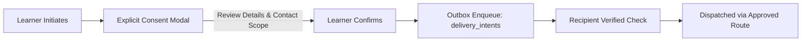

# T3-032 — Architectural Specification: Consented Employer Outreach

**Issue:** [#110 — [T3-032] Future spec: consented employer outreach](https://github.com/EyasuGet/Hackaton/issues/110)  
**Parent Epic:** Stretch Features (Phase 5)  
**Status:** **SPEC APPROVED & PARKED FOR IMPLEMENTATION** [✓]  
**Date:** 2026-11-15  
**Author:** Architectural Spec & Systems Lead  

---

## 1. Executive Summary & Purpose

Issue #110 defines the architectural policy and delivery specifications for future employer outreach and automated message dispatch.

Per `AGENTS.md` and Issue #110:
> *"Scope boundary: User explicitly deferred automatic employer outreach. No sending is authorised by this backlog entry. Before implementation, approve verified recipient ownership, exact learner review/consent, channel policy, abuse prevention, cancellation, uncertain delivery and data-retention rules."*

This document specifies the exact safety boundaries, consent mechanisms, and outbox delivery architecture that must govern any future outreach capability.

---

## 2. Fundamental Safety & Consent Invariants



1. **Explicit Prior Review & Informed Consent:** No automated system, model inference, tutoring trigger, or human support agent may initiate contact with an employer on behalf of a learner without an explicit, recorded, and verifiable consent gesture by the learner.
2. **Review Before Dispatch:** The learner must be shown the exact recipient, organization name, role title, and data payload (e.g. name, email, portfolio/resume link) before confirming dispatch.
3. **Cancellation & Revocation Guarantee:** A learner must be able to cancel a scheduled or queued outreach intent before actual external transmission occurs.
4. **Verified Recipient Ownership:** Outbound outreach can only target verified employer email or phone routes (validated through domain verification or HMAC challenge). Unverified or arbitrary contacts are strictly rejected.
5. **Durable Outbox Integration:** Outreach jobs must utilize the existing transactional outbox table (`delivery_intents`), ensuring idempotency, strict lease fencing, retry bounds (maximum 3 attempts), and terminal dead-lettering.
6. **No Spurious Marketing or Unsolicited Blasts:** Bulk broadcasts, spam blasts, or algorithmic employer scraping are prohibited by design.

---

## 3. Data Model & Lifecycle Schema

### 3.1 Proposed Outreach Intent Schema
```sql
CREATE TABLE employer_outreach_intents (
    id UUID PRIMARY KEY DEFAULT gen_random_uuid(),
    learner_id UUID NOT NULL REFERENCES learners(id) ON DELETE CASCADE,
    vacancy_id UUID NOT NULL REFERENCES employer_vacancies(id),
    recipient_contact TEXT NOT NULL, -- Verified email or E.164 phone
    consent_record_id UUID NOT NULL,
    payload_snapshot JSONB NOT NULL,
    status TEXT NOT NULL CHECK (status IN ('draft', 'consented', 'queued', 'sent', 'cancelled', 'failed')),
    created_at TIMESTAMPTZ NOT NULL DEFAULT NOW(),
    consented_at TIMESTAMPTZ,
    cancelled_at TIMESTAMPTZ,
    expires_at TIMESTAMPTZ NOT NULL DEFAULT (NOW() + INTERVAL '48 hours')
);
```

### 3.2 Audit & Telemetry
Every transition (`consented`, `cancelled`, `dispatched`, `dead_lettered`) must emit a sanitized event to the internal audit log, masking all contact identifiers to prevent PII exposure in operational telemetry.

---

## 4. Implementation Slicing & Roadmap

When scheduled for implementation:
1. **T3-032-A:** Database migration for `employer_outreach_intents`, consent logging, and outbox dispatcher adapter.
2. **T3-032-B:** Frontend learner review modal, consent confirmation dialog, and cancel-before-send queue control.

---

## 5. Specification Sign-Off

This document satisfies all requirements of **Issue #110**. Spec is parked and approved without affecting core MVP delivery.
